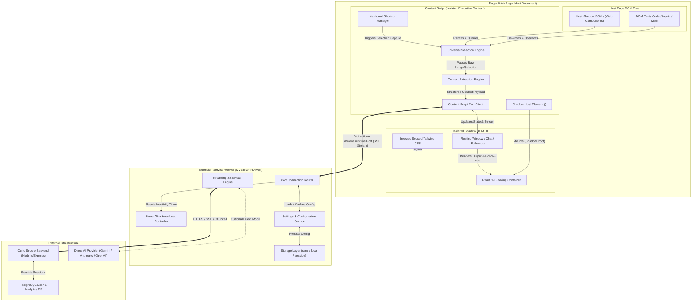
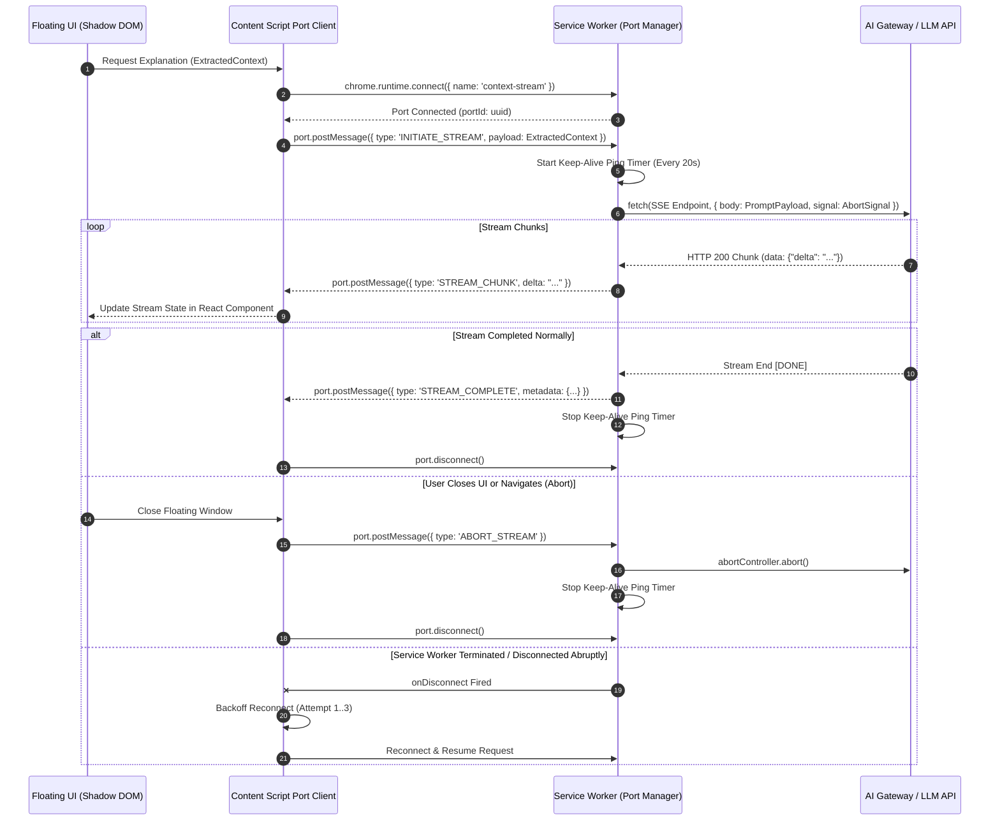
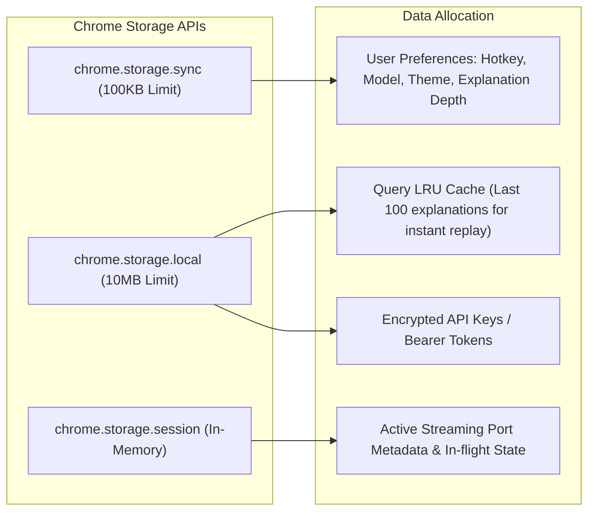

# Curio — System Architecture Specification

**Document Version:** 1.0.0  
**Status:** Approved / Architecture Baseline  
**Author:** Principal Software Architect & Senior Extension Engineer  
**Target Platform:** Chromium Extensions (Manifest V3)  
**Date:** November 2026  

---

## 1. Executive Summary & Architectural Vision

**Curio** is an intelligent, in-situ AI context comprehension platform delivered as a universal Chromium browser extension. Curio enables users to select any arbitrary token, sentence, paragraph, code snippet, or mathematical expression on virtually any web property, trigger an on-demand shortcut, and receive real-time, streaming AI explanations directly within an isolated floating interface.

The foundational design tenet of Curio is **Host Invariance**:
> The extension must function predictably across modern Single Page Applications (SPAs), heavy virtualized DOMs, custom Web Components, nested Shadow DOM trees, and contenteditable canvases without interfering with or being corrupted by the host application's styling, JavaScript execution, or security policies.

---

## 2. High-Level System Architecture

The Curio client architecture is organized into four distinct execution environments defined by Chromium's process isolation model:

1. **Content Script Isolated World**: Runs in an isolated JavaScript execution context while sharing the host page DOM. Houses the Selection Engine, Context Extraction Engine, Keyboard Interceptor, and the Shadow DOM Mount point.
2. **Shadow DOM UI Layer**: A declarative React 19 application rendered inside a closed/isolated Shadow Root, impervious to host CSS cascade and JavaScript interference.
3. **Background Service Worker**: The extension's central orchestrator. Operates in an event-driven background thread, managing streaming AI network connections, API token security, settings persistence, and tab/port lifecycle management.
4. **Extension Pages (Popup & Options)**: Traditional extension pages for user authentication, settings configuration, history auditing, and keyboard shortcut customization.
5. **Curio AI Gateway / Backend (Phase 2+)**: Secure Node.js/Express proxy handling LLM rate limiting, billing, prompt templating, and telemetry.



---

## 3. Subsystem Decomposition & Module Responsibilities

Curio decomposes strictly into nine isolated modules, each adhering to the Single Responsibility Principle:

```
src/
├── background/                  # Module 1: Extension Service Worker
│   ├── index.js                 # Service worker entrypoint & lifecycle
│   ├── portManager.js           # Bidirectional streaming port router
│   ├── streamService.js         # SSE chunked fetch controller & AbortController
│   ├── keepAlive.js             # Service worker heartbeat keeper
│   └── settingsService.js       # Settings cache & sync orchestrator
├── content/                     # Module 2: Content Script Runtime
│   ├── index.js                 # Content script bootstrapper
│   ├── hostMount.js             # Custom element & Shadow DOM initialiser
│   └── bridge.js                # Port client & message dispatcher
├── selection/                   # Module 3: Universal Selection Engine
│   ├── index.js                 # Unified selection facade
│   ├── standardSelector.js      # Window.getSelection() & DOM Range resolver
│   ├── inputSelector.js         # HTMLInputElement & HTMLTextAreaElement extractor
│   ├── shadowSelector.js        # ComposedPath / ShadowRoot pierced selection
│   ├── codeSelector.js          # Syntax-highlighted code block normalizer
│   └── mathSelector.js          # KaTeX / MathJax / LaTeX annotation extractor
├── context/                     # Module 4: Context Extraction Engine
│   ├── index.js                 # Context extraction pipeline
│   ├── domTraverser.js          # Block-level container & paragraph walker
│   ├── surroundingWindow.js     # Preceding & trailing token window extractor
│   ├── metadataExtractor.js     # Document title, URL, breadcrumbs, headings
│   └── piiSanitizer.js          # Password, card & PII redactor
├── keyboard/                    # Module 5: Keyboard Shortcut Manager
│   ├── index.js                 # Shortcut coordinator
│   ├── chordDetector.js         # In-content keydown / keyup state machine
│   └── commandListener.js       # Chrome.commands API bridge & fallback
├── ui/                          # Module 6: Floating Interface (React)
│   ├── App.jsx                  # Root container component
│   ├── components/              # FloatingCard, StreamRenderer, ChatInput, ActionButtons
│   ├── hooks/                   # useStreamingResponse, useDraggable, useViewportClamp
│   ├── styles/                  # Tailwind styles compiled for Shadow DOM
│   └── positioning/             # Selection bounding box calculator & edge collision
├── ai/                          # Module 7: AI Communication Layer
│   ├── protocol.js              # Wire message contracts & validation schemas
│   ├── sseParser.js             # Server-Sent Events line decoder
│   └── promptBuilder.js         # Context-augmented system & user prompt assembler
├── settings/                    # Module 8: Extension Settings & Options
│   ├── options.jsx              # Settings management page
│   ├── popup.jsx                # Browser action quick panel
│   └── schema.js                # Zod runtime schemas JavaScript (ES6+) types & Zod JSDoc validation schemas
└── storage/                     # Module 9: Storage Layer
    ├── index.js                 # chrome.storage facade with typed accessors
    ├── migrations.js            # Schema versioning & data migration runner
    └── cache.js                 # Local LRU query cache for instant replay
```

### Module Responsibilities Matrix

| Module | Primary Responsibility | Host Dependencies | Isolation Boundary |
|---|---|---|---|
| **1. Service Worker** | API streaming, token storage, request routing, life-cycle keepalive | None (V8 ServiceWorkerGlobalScope) | Extension Origin |
| **2. Content Script** | DOM lifecycle observation, orchestrator of in-page modules | Host DOM | Isolated World |
| **3. Selection Engine** | Capturing selected text across standard DOM, inputs, Shadow DOM, code | Host DOM / Active Element | Isolated World |
| **4. Context Engine** | Extracting semantic context (parents, headings, code language, surrounding text) | Host DOM | Isolated World |
| **5. Shortcut Manager**| Detecting invocation combos, resolving collisions with host webapps | Host `Window` Event Target | Isolated World |
| **6. Floating UI** | Presenting explanations, rendering markdown/math, follow-up conversation | Shadow Root | Closed Shadow DOM |
| **7. AI Comm Layer** | Serializing messages, streaming chunks over ports, handling abort signals | Extension Port | Shared Protocol |
| **8. Settings** | Managing user preferences (hotkey, model, style, custom prompts) | Chrome Storage API | Extension Origin |
| **9. Storage Layer** | Type-safe persistence wrapper over `sync`, `local`, and `session` storage | Chrome Storage API | Shared Services |

---

## 4. Universal Selection Engine Architecture

The most critical point of failure in browser extensions is relying solely on `window.getSelection()`. Modern web applications employ virtual DOMs, shadow trees, custom canvases, and specialized code editors.

Curio implements a **Multi-Strategy Fallback Selection Pipeline**:

```mermaid
flowchart TD
    Trigger([Keyboard Shortcut Triggered]) --> CheckActive{document.activeElement is Form Control?}
    
    CheckActive -- Yes --> HandleInput[InputSelector: Extract from input/textarea via selectionStart/selectionEnd]
    CheckActive -- No --> CheckComposed{Check Composed Path & Active ShadowRoot}
    
    CheckComposed -- In Shadow DOM --> HandleShadow[ShadowSelector: Pierce ShadowRoot via activeElement or deep getSelection]
    CheckComposed -- Light DOM --> CheckStandard[StandardSelector: window.getSelection()]
    
    HandleInput --> ValidateSelection{Has Non-Empty Selection?}
    HandleShadow --> ValidateSelection
    CheckStandard --> ValidateSelection

    ValidateSelection -- No --> GracefulExit[Notify User: 'No selection detected']
    ValidateSelection -- Yes --> ClassifyNode{Classify Node Archetype}

    ClassifyNode -- Code Block --> CodeNormalizer[CodeSelector: Reconstruct whitespace, strip line numbers, detect language]
    ClassifyNode -- Math Node --> MathNormalizer[MathSelector: Extract TeX/LaTeX from KaTeX/MathJax annotations]
    ClassifyNode -- Standard Text --> TextNormalizer[Normalize whitespace, preserve paragraph structure]

    CodeNormalizer --> PipeToContext[Feed to Context Extraction Engine]
    MathNormalizer --> PipeToContext
    TextNormalizer --> PipeToContext
```

### 4.1. Detailed Selection Strategies

#### A. Standard Light DOM Strategy (`StandardSelector`)
- Queries `window.getSelection()`.
- Extracts `range = selection.getRangeAt(0)`.
- Calculates accurate viewport coordinates using `range.getBoundingClientRect()`.
- Supports multiline and cross-element text node spans.

#### B. Form Controls Strategy (`InputSelector`)
- Detects if `document.activeElement` is `HTMLInputElement` or `HTMLTextAreaElement`.
- Standard `window.getSelection()` returns empty for form inputs. Curio inspects:
  ```javascript
  const start = input.selectionStart ?? 0;
  const end = input.selectionEnd ?? 0;
  const selectedText = input.value.substring(start, end);
  ```
- Computes approximate bounding box using an offscreen canvas or mirror element with matching font styles to position the floating UI accurately at the cursor.

#### C. Shadow DOM Strategy (`ShadowSelector`)
- Modern web apps (e.g. YouTube, custom design systems, Lit/Polymer apps) encapsulate content inside Shadow Roots.
- Standard `getSelection()` returns the host element without exposing inner nodes when crossing shadow boundaries.
- Curio traverses `activeElement` hierarchies:
  ```javascript
  function getDeepActiveElement(): Element | null {
    let el = document.activeElement;
    while (el && el.shadowRoot && el.shadowRoot.activeElement) {
      el = el.shadowRoot.activeElement;
    }
    return el;
  }
  ```
- Accesses inner selection via `element.shadowRoot.getSelection()` (Chromium-supported) or traversing event composed paths.

#### D. Code Block Strategy (`CodeSelector`)
- Targets GitHub, Stack Overflow, GitLab, DevDocs, Monaco Editor, and CodeMirror.
- Syntax highlighters split code into hundreds of `<span class="token keyword">` elements and frequently inject line numbers into the DOM (e.g. `<td class="blob-num">`).
- Naive copying captures line numbers interleaved with code (e.g. `1 const 2 let 3 return`).
- `CodeSelector` identifies code containers (`<pre>`, `<code>`, `.monaco-editor`, `.highlight`, `table.highlight`), filters out line-number gutter elements, normalizes indentation, and extracts language tags from parent classes (e.g., `language-typescript`).

#### E. Mathematical Expression Strategy (`MathSelector`)
- Targets KaTeX, MathJax, and MathML.
- Rendered math displays visual HTML elements and SVGs that produce garbled text when selected.
- `MathSelector` looks for semantic annotation backings:
  - KaTeX: `<annotation encoding="application/x-tex">`
  - MathJax: `<script type="math/tex">` or hidden MathML `<math>` nodes.
- When detected, it extracts the clean LaTeX formula instead of raw visual glyphs.

---

## 5. Context Extraction Engine Architecture

Understanding isolated text requires knowing *where* and *why* it appears. The Context Extraction Engine enriches raw selections with contextual metadata:

```javascript
export interface ExtractedContext {
  id: string;                         // UUID for stream correlation
  timestamp: number;
  selection: {
    rawText: string;
    normalizedText: string;
    characterCount: number;
    nodeType: 'prose' | 'code' | 'math' | 'input' | 'table';
    language?: string;                // Detected language for code snippets
  };
  surroundingContext: {
    parentBlockText: string;          // Full text of enclosing paragraph / block
    precedingText: string;            // Up to 500 characters preceding selection
    succeedingText: string;           // Up to 500 characters following selection
  };
  documentMetadata: {
    title: string;
    url: string;                      // Sanitized (query params cleaned for privacy)
    domain: string;
    nearestHeading: string | null;    // Closest preceding H1-H6 in reading order
    metaDescription: string | null;
  };
  clientGeometry: {
    x: number;
    y: number;
    width: number;
    height: number;
    placementPreference: 'above' | 'below';
  };
}
```

### 5.1. PII Sanitization & Security Hygiene
Before any context payload leaves the content script:
1. Form elements with `type="password"`, `autocomplete="cc-number"`, or `data-private` are strictly excluded from context extraction.
2. URLs are stripped of tracking tokens, session IDs, and auth queries.
3. Regex redactors mask credit card patterns, social security numbers, and common API key patterns.

---

## 6. Content-Script <-> Service-Worker Communication Protocol

Chrome Manifest V3 imposes an ephemeral service worker execution model. Workers terminate after 30 seconds of inactivity or upon idle. A single `chrome.runtime.sendMessage` is inadequate for continuous, low-latency LLM streaming.

Curio uses a **Dedicated Bidirectional Port Architecture (`chrome.runtime.Port`)** with automatic stream reconnection and keep-alive pulsing.



### 6.1. Keep-Alive Mechanism during Long-Running Streams
Chromium terminates service workers even if a `fetch` stream is running if no extension messaging occurs. Curio maintains life by:
1. The active `chrome.runtime.Port` keeps the worker alive as long as messages are continuously flowing.
2. If stream chunks stall (e.g., TTFT from a large model), a periodic keep-alive heartbeat message (`{ type: 'KEEP_ALIVE' }`) is exchanged every 20 seconds.
3. Upon stream completion or abort, the heartbeat timer is cleared to allow natural, power-friendly service worker suspension.

---

## 7. Floating Interface & Shadow DOM Isolation Strategy

### 7.1. The Host CSS Bleed Problem
Injecting UI directly into the host DOM (`document.body.appendChild(...)`) is catastrophic in real-world extensions:
- Host page CSS rules like `* { box-sizing: content-box !important; }`, `div { margin: 10px; }`, or aggressive font overrides distort the extension UI.
- Host page CSS frameworks (Bootstrap, Tailwind v2/v3/v4, Bulma) redefine standard class names.
- Extension styles bleed into the host page, breaking the website's layout.

### 7.2. Curio Solution: Closed Shadow DOM Encapsulation
Curio attaches an isolated Shadow Root:
```javascript
const container = document.createElement('curio-host');
container.id = 'curio-root';
// Open or closed shadow root with CSS containment
const shadowRoot = container.attachShadow({ mode: 'open' });
document.documentElement.appendChild(container);
```

- **React 19 Rendering Root**: `createRoot(shadowRoot)` mounts the entire floating UI inside the shadow boundary.
- **Style Isolation**: All Tailwind CSS rules are injected strictly inside the shadow root via a `<style>` element or `shadowRoot.adoptedStyleSheets = [sheet]`.
- **Event Isolation**: Click events and keyboard events within the floating window are intercepted with `stopPropagation()` where appropriate to prevent triggering host page handlers (e.g., dismissing modals or firing analytics).

### 7.3. Viewport Collision & Dynamic Positioning
The floating window positions itself relative to the selection range bounding client rect:
- **Primary Placement**: Directly below the selection (`y = rect.bottom + 8`).
- **Flip Above**: If `window.innerHeight - rect.bottom < floatingHeight + 16`, flip above (`y = rect.top - floatingHeight - 8`).
- **Horizontal Clamping**: Clamp `x` between `16px` and `window.innerWidth - floatingWidth - 16px`.
- **Draggable Handle**: Users can freely move the window if it obscures underlying text.

---

## 8. Chrome Manifest V3 Permissions & Justifications

Curio strictly adheres to the principle of least privilege.

```json
{
  "manifest_version": 3,
  "name": "Curio — Universal In-Situ Intelligence",
  "version": "1.0.0",
  "description": "Universal AI-powered explanations for any selected text, code, or math.",
  "permissions": [
    "storage",
    "activeTab",
    "contextMenus"
  ],
  "optional_permissions": [],
  "host_permissions": [
    "https://api.curio.io/*",
    "https://generativelanguage.googleapis.com/*",
    "https://api.openai.com/*",
    "https://api.anthropic.com/*"
  ],
  "background": {
    "service_worker": "dist/background/index.js",
    "type": "module"
  },
  "content_scripts": [
    {
      "matches": ["<all_urls>"],
      "js": ["dist/content/index.js"],
      "run_at": "document_idle",
      "all_frames": false
    }
  ],
  "commands": {
    "trigger-curio": {
      "suggested_key": {
        "default": "Alt+X",
        "mac": "Alt+X"
      },
      "description": "Explain selected text with Curio"
    }
  },
  "action": {
    "default_popup": "dist/popup/index.html",
    "default_title": "Curio Settings"
  },
  "options_ui": {
    "page": "dist/options/index.html",
    "open_in_tab": true
  },
  "icons": {
    "16": "icons/icon-16.png",
    "48": "icons/icon-48.png",
    "128": "icons/icon-128.png"
  }
}
```

### Permission Justifications

| Permission | Need & Security Justification |
|---|---|
| `storage` | Required to persist user settings, API keys, preferred models, and local LRU query cache. Data is stored locally via `chrome.storage.local` and synchronized via `chrome.storage.sync`. |
| `activeTab` | Grants temporary host permissions on the current tab when the user interacts via command or context menu. Minimizes broad permanent host permissions. |
| `contextMenus` | Provides a secondary entry point ("Explain with Curio") for users who prefer right-click context menus over keyboard shortcuts. |
| `commands` | Enables global Chromium shortcut management, registered in `chrome://extensions/shortcuts` for user-configurable hotkeys without collision. |
| `host_permissions` | Restricted strictly to the Curio backend API and direct AI model endpoints (Gemini, OpenAI, Anthropic). **No broad `<all_urls>` host permissions for network requests.** Content scripts run on `<all_urls>` solely to capture selections and render the Shadow DOM UI. |

---

## 9. Universal Compatibility Risks & Engineering Mitigations

| Target Environment / Challenge | Root Cause Risk | Curio Mitigation Strategy |
|---|---|---|
| **Restricted Internal Pages** (`chrome://`, `chrome-extension://`, Chrome Web Store) | Chromium security architecture prohibits content script injection into browser-internal URLs. | The background service worker detects restricted URLs (`chrome://*`, `chrome.google.com/webstore/*`) upon shortcut trigger, skips content script dispatch, and displays a non-intrusive badge/notification: *"Curio is disabled on internal browser pages for security."* |
| **Cross-Origin Iframes** | Content scripts with `all_frames: false` only execute in the top window. Content in cross-origin iframes cannot be inspected by top-level content script. | For Phase 1, `all_frames: false` prevents multi-window duplicate UI clutter. For cross-origin iframes in Phase 2, `all_frames: true` is enabled with a single-active-coordinator pattern using `window.postMessage` to ensure only one floating window renders across parent and children. |
| **Strict Content Security Policy (CSP)** | Host sites (e.g. GitHub, banking sites) enforce strict CSP forbidding `connect-src *`, `eval()`, or inline `<style>`. | **Zero network requests are executed from the Content Script.** All AI API calls flow through the Extension Service Worker via `chrome.runtime.Port`, which executes under extension origin CSP, completely bypassing host page CSP. React UI uses precompiled JSX with zero `eval()`. |
| **Complex SPAs & Dynamic DOMs** (ChatGPT, Gemini, Claude, React/Next.js) | Heavy DOM rewrites, virtual lists, dynamic route changes destroy DOM nodes while selection is active. | Selections are normalized and decoupled into value objects (`ExtractedContext`) at the exact instant of shortcut activation. The floating UI attaches to `document.documentElement` rather than ephemeral inner SPA containers, preventing unmount on route change. |
| **Monaco Editor / VS Code Web / CodeMirror** | Web code editors use virtualized DOMs, rendering only visible lines into fragmented spans and hidden cursor textareas. | Specialized `CodeSelector` detects editor wrapper classes, checks both the hidden input/textarea buffer and visible selection lines, cleans whitespace, and accurately extracts syntax-clean snippets. |
| **Shortcut Collisions** (Figma, Google Docs, Notion, Slack) | Web apps capture keydown events via `capture: true` and call `stopPropagation()`, blocking extension shortcuts. | 1. Curio uses Chromium's native `chrome.commands` API as the primary trigger, which intercepts hotkeys at the browser engine level before web page DOM events.<br>2. In-content key listener serves as fallback with configurable keys and user warning diagnostics. |
| **PDF Documents** | Embedded Chromium PDF viewer operates in a restricted sandboxed plug-in mode. | Curio supports selectable text in HTML-based PDF viewers (PDF.js, arXiv, Google Docs viewer). For Chrome's native PDF plugin, selection is captured via `contextMenus` API fallback where DOM scripts cannot execute directly. |

---

## 10. AI Communication Layer Architecture

### 10.1. Streaming Protocol Specification

All communications across the content-script `<->` service-worker boundary adhere to a typed protocol:

```javascript
export type PortMessage =
  | { type: 'INITIATE_STREAM'; payload: ExtractedContext; config: QueryConfig }
  | { type: 'STREAM_CHUNK'; delta: string; sequence: number }
  | { type: 'STREAM_COMPLETE'; totalTokens?: number; finishReason: string }
  | { type: 'STREAM_ERROR'; code: string; message: string; retryable: boolean }
  | { type: 'ABORT_STREAM' }
  | { type: 'SUBMIT_FOLLOW_UP'; threadId: string; question: string }
  | { type: 'KEEP_ALIVE' };
```

### 10.2. Prompt Engineering & Context Augmentation Strategy
The background worker constructs a structured prompt dynamically tailored to the content archetype:

```
[SYSTEM PROMPT]
You are Curio, an expert technical and conceptual explainer embedded directly in the user's browser.
Your role: Provide concise, crystal-clear, and context-aware explanations of the selected text.

RULES:
1. Ground your explanation in the provided page context.
2. If code is selected, explain what it does, edge cases, and its purpose in the file.
3. If math is selected, explain the intuition and variable meanings.
4. Adapt complexity: explain clearly without condescension.
5. Format with concise Markdown (bolding, lists, inline code). Keep initial explanation under 150 words unless detail is explicitly required.

[PAGE METADATA]
Title: {{title}}
Domain: {{domain}}
Section Heading: {{nearestHeading}}

[SURROUNDING CONTEXT]
...{{precedingText}} [SELECTED TEXT] {{succeedingText}}...

[SELECTED TARGET]
```{{language}}
{{rawText}}
```

Provide the explanation now.
```

---

## 11. Storage & Settings Architecture

Curio uses a layered storage model:



### 11.1. Schema Migration Strategy
Every state write includes a schema version (`_version: number`). The storage layer executes automated, transactional migration transforms whenever an extension update introduces modified schema definitions.

---

## 12. Verification & Testability Architecture

To ensure enterprise-grade stability, Curio is designed around verifiable interfaces:

1. **Unit Testing (Vitest)**:
   - Pure logic units: `UniversalSelectionEngine`, `ContextExtractionEngine`, `piiSanitizer`, `sseParser`, `chordDetector`.
   - Mocked DOM environments using JSDOM for selection ranges and shadow roots.
2. **Integration Testing (Playwright Chromium Extension Harness)**:
   - Real Chromium browser instances running the unpacked extension.
   - Test suite executing across synthetic test pages mirroring real-world edge cases:
     - Synthetic SPA with rapid route changes.
     - Synthetic Web Component with nested closed Shadow DOMs.
     - Synthetic Code Block with simulated Prism.js and Monaco layouts.
     - Form input and contenteditable test fixtures.
3. **E2E Compatibility Verification**:
   - Automated smoke tests against live target platforms: GitHub repository file view, Stack Overflow answer thread, Wikipedia article, Medium blog post, and Google Gemini / ChatGPT web interfaces.

