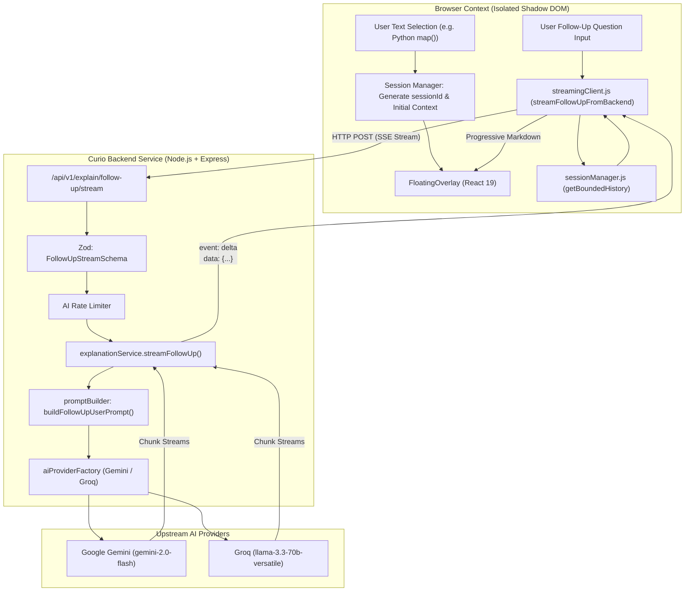

# Curio — Conversational AI and Contextual Follow-Up Engine Specification

> **Continuous, Multi-Turn In-Situ Intelligence Over Highlighted Web Content**  
> Built with pure JavaScript (ES6+), React 19 JSX, Node.js + Express, Google Gemini, Groq, and W3C Server-Sent Events (SSE).

---

## 1. Executive Summary & Objective

The **Curio Conversational AI Engine** empowers readers, researchers, and software engineers to engage in continuous, multi-turn dialogues regarding any content selected on a webpage. Rather than treating each query as an isolated one-off lookup, Curio binds follow-up questions to the original reading context.

### Example Interaction Flow

1. **Initial Selection**:  
   User highlights `Python map()` in technical documentation.  
   *Curio Explains*: Core definition, transformation semantics, parameters, return generator type, and execution examples.
2. **Follow-Up 1 (Conceptual Contrast)**:  
   User asks: *"What is the difference between map() and filter()?"*  
   *Curio Retains Context*: Directly compares `map()` and `filter()`, referencing how `filter()` takes a truthy predicate function while `map()` applies a transformer to all elements.
3. **Follow-Up 2 (Refinement / Implementation)**:  
   User asks: *"Show me an example using lambda."*  
   *Curio Retains Thread*: Produces an idiomatic `list(map(lambda x: x * 2, numbers))` snippet without requiring the user to retype what "map" was or what language is being discussed.

---

## 2. Core Architecture & Pipeline



---

## 3. Conversational Memory & Bounded History

To prevent token window explosion, high latency, and compounding billing costs, Curio implements **Bounded Conversational Memory** without introducing heavyweight vector databases for everyday short browsing sessions.

### Memory Strategies

1. **Sliding Window of Recent Turns**:
   - The engine maintains up to 6 recent message turns (3 user questions, 3 AI answers) verbatim.
   - Recent turns provide exact lexical and semantic continuity for immediate pronouns (e.g., *"it"*, *"that function"*, *"the previous snippet"*).

2. **Automated History Condensation (Summarization)**:
   - When conversations expand beyond 8 turns, earlier exchanges are automatically condensed into a compact bulleted summary:
     ```markdown
     <earlier_conversation_summary>
     - Q: "What is map()?" → A: Built-in transformation function across iterables.
     - Q: "Difference from filter()?" → A: Filter selects by predicate; map transforms all.
     </earlier_conversation_summary>
     ```
   - This condensed summary is preserved alongside the sliding window, ensuring long dialogues never forget their foundational discoveries.

3. **Invariable Anchor Context**:
   - Every single follow-up prompt, regardless of depth, permanently includes the **original selected text** and **surrounding DOM block** enclosed in explicit security delimiters (`<original_selected_text>` and `<original_context>`).

---

## 4. Prompt Engineering & Untrusted Data Isolation

Webpage selections and user input represent untrusted data. Curio constructs multi-tiered prompts that defend against prompt injection while instructing the LLM to maintain continuous dialogue:

```markdown
The user is engaged in a continuous follow-up conversation regarding this selected topic.
Session ID: curio_sess_m3a9j1_k9z2

<original_selected_text>
Python map()
</original_selected_text>

<original_context>
numbers = [1, 2, 3, 4]
squared = map(lambda x: x**2, numbers)
</original_context>

<earlier_conversation_summary>
- Q: "What is map()?" → A: Applies a function across an iterable yielding a generator.
</earlier_conversation_summary>

<previous_explanation>
map(function, iterable, ...) returns an iterator that computes the function using arguments from each of the iterables.
</previous_explanation>

<user_follow_up_question>
Show me how to use map with multiple lists.
</user_follow_up_question>

CRITICAL CONVERSATIONAL INSTRUCTIONS:
- Directly answer the user's follow-up question in the context of the original selected topic (Python map()).
- Reference previous explanation points naturally without duplicating the entire explanation.
- If the user asks for code, comparisons, or alternatives, provide a focused, idiomatic answer with syntax-highlighted code.
- Maintain the selected explanation depth level.
```

---

## 5. Streaming Protocol & Upstream Cancellation

Curio uses native **W3C Server-Sent Events (SSE)** over HTTP POST:

### Event Wire Format
```http
HTTP/1.1 200 OK
Content-Type: text/event-stream
Cache-Control: no-cache, no-transform
Connection: keep-alive

event: start
data: {"requestId":"req_fu_8b21...","provider":"gemini","model":"gemini-2.0-flash"}

event: delta
data: {"text":"When "}

event: delta
data: {"text":"passing multiple lists..."}

event: done
data: {"requestId":"req_fu_8b21...","provider":"gemini","usage":{"inputTokens":124,"outputTokens":48}}
```

### AbortController Cancellation
When the user clicks **Stop** or presses **Esc**:
1. `followUpAbortRef.current.abort()` fires on the client.
2. The browser immediately terminates the HTTP fetch request and calls `reader.cancel()`.
3. The Node.js Express server detects `req.on('close')`, causing `signal.aborted === true`.
4. The backend immediately cancels the upstream `fetch()` to Google Gemini or Groq, releasing API resources and preventing quota consumption.
5. The UI marks the conversational turn as `status: 'cancelled'` and displays an inline **Retry** option.

---

## 6. Conversational Actions in the Floating UI

The React 19 floating interface (`FloatingOverlay.jsx`) includes dedicated conversational controls:

| Control | Action | User Benefit |
| :--- | :--- | :--- |
| **Stop Generation** | Cancels in-progress stream | Halts runaway responses or accidental queries instantly. |
| **Retry Question** | One-click regeneration on failed/cancelled turns | Fixes network glitches or quota hiccups without retyping questions. |
| **Copy Turn** | Copies individual response or code block | Clean clipboard export with 2-second visual confirmation pill. |
| **Clear Chat** | Wipes follow-up history back to base explanation | Resets the conversation thread without re-selecting text. |
| **Turn Counter** | Displays active turn number (e.g. `3 turns`) | Informs user of thread depth and context accumulation. |
| **Prompt Chips** | Contextual one-tap questions | Jumpstarts follow-ups with *"💡 Real-world example"*, *"⚠️ Common pitfalls"*, *"⚖️ Alternatives"*. |

---

## 7. Privacy & Ephemeral Data Policy

1. **Zero Unsolicited Data Collection**: Only the text explicitly highlighted by the user and its immediate enclosing paragraph are sent to the AI backend.
2. **Ephemeral Active Thread**: Active conversation turns live exclusively in browser memory during the active session. If the user dismisses the overlay or navigates away, the temporary conversation memory is discarded unless explicitly saved via the **Bookmark** action into the local Learning Hub.
3. **No Third-Party Telemetry**: Conversations are not tracked, logged, or shared with analytics providers.
