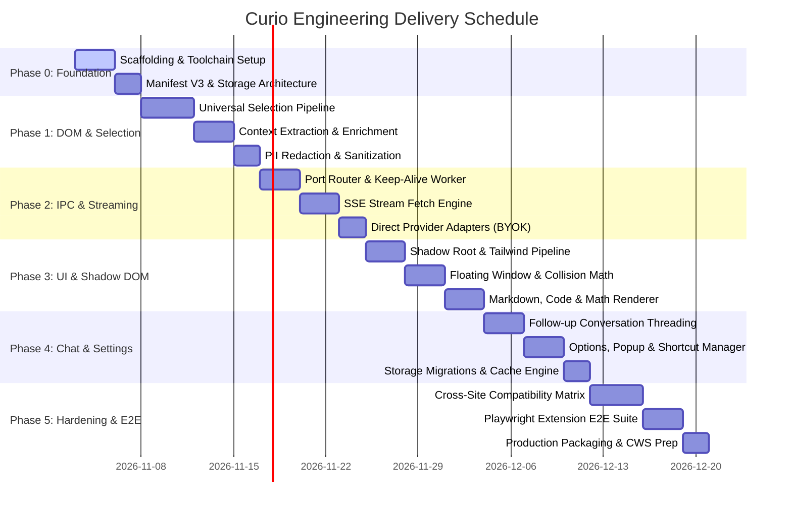

# Curio — Engineering Implementation & Development Plan

**Document Version:** 1.0.0  
**Project:** Curio (Universal In-Situ AI Browser Extension)  
**Status:** Approved Roadmap  
**Role:** Principal Software Architect & Lead Engineer  
**Date:** November 2026  

---

## 1. Roadmap Overview & Strategic Phasing

The Curio engineering roadmap is structured into 6 sequential phases, transitioning from foundational infrastructure to complex DOM engines, streaming protocols, reactive Shadow DOM interfaces, and enterprise cross-site hardening.

---

## 2. Detailed Phase Breakdown & Acceptance Criteria

### Phase 0: Foundation, Scaffolding & Multi-Target Build Toolchain
**Objective:** Establish a production-grade development environment capable of compiling Manifest V3 multi-entry bundles, inline Shadow DOM stylesheets, and unit test harnesses.

#### Work Packages
- **WP 0.1: Build System Scaffolding**: Configure Vite 6 + JavaScript (ES6+) with Rollup multi-input configurations for:
  - `background/index.js` (Service Worker module).
  - `content/index.js` (Content Script IIFE / module).
  - `popup/index.html` (Extension popup UI).
  - `options/index.html` (Options management UI).
- **WP 0.2: Shadow DOM Style Pipeline**: Configure PostCSS and Tailwind CSS to output an inline string bundle (`import css from './styles.css?inline'`) for zero-bleed injection into the Shadow Root via `adoptedStyleSheets`.
- **WP 0.3: Manifest V3 Specification**: Construct strict `manifest.json` with least-privilege permissions (`storage`, `activeTab`, `contextMenus`, `commands`).
- **WP 0.4: Developer Harness & Quality Gates**: Set up pure JavaScript (ES6+) standards, runtime validation with Zod, JSDoc type contracts, and Node test runner (`node:test`).

#### Acceptance Criteria
1. `npm run build` compiles clean bundles into `/dist` with zero type errors.
2. Manifest V3 loads into `chrome://extensions` in developer mode without warnings or errors.
3. Tailwind styles compile into an isolated string that can be adopted by a Shadow Root without polluting host CSS.
4. Automated pre-commit hooks enforce formatting and type checking.

---

### Phase 1: Universal Selection Engine & Context Extraction Engine
**Objective:** Capture user selections accurately across all web archetypes and enrich them with surrounding context while sanitizing sensitive data.

#### Work Packages
- **WP 1.1: Selection Strategy Pipeline (`UniversalSelectionEngine`)**:
  - Implement `InputSelector`: Reads `selectionStart`/`selectionEnd` from active `<input>` and `<textarea>` elements.
  - Implement `ShadowSelector`: Detects active `shadowRoot` elements and pierces boundaries via deep active element traversal.
  - Implement `CodeSelector`: Traverses `<pre>`, `<code>`, Monaco, and CodeMirror editors; strips line number gutters and normalizes leading indentation.
  - Implement `MathSelector`: Extracts clean TeX/LaTeX from KaTeX `<annotation>` and MathJax `<script type="math/tex">` nodes.
  - Implement `StandardSelector`: Standard DOM `window.getSelection()` range calculation.
- **WP 1.2: Context Extraction Engine (`ContextExtractionEngine`)**:
  - Walk DOM upward from `Range.commonAncestorContainer` to find the enclosing block (`
`, `
`, `<article>`, `<blockquote>`).
  - Extract preceding and trailing text buffer (sliding window of 500 characters).
  - Retrieve document metadata (sanitized URL, title, nearest `<h1>`-`<h6>` ancestor).
- **WP 1.3: PII Redaction & Security Filter (`piiSanitizer`)**:
  - Automatically ignore password fields (`type="password"`) and fields marked `autocomplete="cc-number"`.
  - Scrub URLs of sensitive query parameters (e.g., `token`, `session`, `auth`).
  - Mask regex patterns matching credit cards and API tokens before context dispatch.

#### Acceptance Criteria
1. Unit tests pass for 5 selection strategies with >95% statement coverage.
2. Successfully extracts selections from `<textarea>` and `<input>` with cursor coordinates.
3. Successfully strips line numbers from GitHub and Stack Overflow code blocks.
4. Correctly extracts LaTeX from KaTeX rendered mathematical equations.
5. All PII and sensitive fields are masked before leaving the content script.

---

### Phase 2: Service Worker & Port-Based Streaming AI Pipeline
**Objective:** Establish robust, low-latency, bidirectional streaming communication between Content Scripts and Service Workers, resilient against worker suspension.

#### Work Packages
- **WP 2.1: Port Connection Router (`PortManager`)**:
  - Implement named connection listener (`chrome.runtime.onConnect`) for `'curio-stream'`.
  - Maintain active port registry mapped by tab ID and query ID.
  - Handle graceful disconnection, aborts, and client unloads.
- **WP 2.2: Worker Keep-Alive Controller (`KeepAliveHeartbeat`)**:
  - Transmit lightweight ping messages (`KEEP_ALIVE`) every 20 seconds during active stream generation to prevent MV3 30-second suspension.
  - Release timer immediately upon stream completion or cancellation.
- **WP 2.3: Chunked SSE Streaming Engine (`StreamService`)**:
  - Implement `fetch` with `ReadableStream` reader in the Service Worker.
  - Decode Server-Sent Events (SSE) line-by-line (`sseParser.js`).
  - Dispatch ordered delta chunks (`STREAM_CHUNK`) over the port with sequence numbers.
- **WP 2.4: Direct Provider Adapters (BYOK Mode)**:
  - Implement Google Gemini API adapter (`v1beta/models/gemini-2.0-flash:streamGenerateContent`).
  - Implement OpenAI / Anthropic streaming adapters with uniform delta normalization.
  - Implement `AbortController` integration for instant stream cancellation.

#### Acceptance Criteria
1. Continuous streaming text flows from Service Worker to Content Script without token drops.
2. Service Worker does not shut down during a 60-second simulated streaming response.
3. Closing the port or calling `ABORT_STREAM` terminates the underlying HTTP `fetch` immediately.
4. Handles network failures and invalid API keys with typed, retryable error messages.

---

### Phase 3: Floating Interface & Shadow DOM Isolation
**Objective:** Deliver a responsive, isolated, non-intrusive floating UI inside the host webpage, positioned intelligently without layout shifts.

#### Work Packages
- **WP 3.1: Host Custom Element & Shadow Root Mount (`HostMount`)**:
  - Inject `<curio-host id="curio-root">` into `document.documentElement`.
  - Attach isolated Shadow Root with closed/controlled boundary.
  - Adopt precompiled Tailwind CSS stylesheet via `adoptedStyleSheets`.
  - Mount React 19 root (`createRoot(shadowRoot)`).
- **WP 3.2: Floating Card & Viewport Collision Engine (`FloatingPositioner`)**:
  - Compute coordinates based on selection bounding box (`Range.getBoundingClientRect()`).
  - Intelligent edge clamping: Prevents overflowing viewport boundaries.
  - Flip logic: Flips above selection if insufficient space below.
  - Implement draggable header handle allowing users to reposition the card freely.
- **WP 3.3: Streaming Markdown, Code & Math Renderer**:
  - Render streaming text incrementally without layout jumps.
  - Syntax highlight code snippets inside explanations using Prism or low-overhead tokenizer.
  - Render inline math using KaTeX.
  - Action bar: "Copy", "Explain Simpler", "Deep Dive", "Provide Code Example", "Close".

#### Acceptance Criteria
1. Floating UI renders on arbitrary test pages without adopting any host page styles.
2. Injected Tailwind CSS does not leak into the host document.
3. Floating card positions cleanly near selection and never renders outside the viewport.
4. Draggable handle moves the window smoothly with 60 FPS performance.
5. Markdown formatting, code blocks, and inline math render smoothly during live streaming.

---

### Phase 4: Follow-up Conversation, Settings & Storage Engine
**Objective:** Allow interactive follow-up questions, user personalization, and persistent settings with data migrations.

#### Work Packages
- **WP 4.1: Threaded Follow-up Engine**:
  - Conversational memory: Retain original context and prior assistant responses within active session.
  - Floating UI input box: Allows user to ask follow-up questions directly within the card.
  - Multi-turn prompt construction in Service Worker.
- **WP 4.2: Keyboard Shortcut Coordinator (`KeyboardManager`)**:
  - Native `chrome.commands` listener for `Alt+X` / `Command+Option+X`.
  - Fallback in-content capture listener for web apps that attempt to suppress commands.
  - Conflict warning banner when host app consumes hotkey.
- **WP 4.3: Options & Popup UI**:
  - React-based settings page: API key management, model selector (Gemini 2.0 Flash, Claude 3.5 Sonnet, GPT-4o), default explanation length/depth, theme toggle.
  - Popup quick menu: Enable/disable toggle, recent queries history list, shortcut quick-remap link.
- **WP 4.4: Tiered Storage Layer & LRU Cache (`StorageEngine`)**:
  - Synchronize lightweight preferences via `chrome.storage.sync`.
  - Store encrypted credentials and LRU query cache (last 100 queries) in `chrome.storage.local`.
  - Transactional migration manager for schema upgrades (`_version`).

#### Acceptance Criteria
1. User can ask follow-up questions within the active floating window without context loss.
2. Hotkey `Alt+X` reliably triggers extraction and displays floating window.
3. Settings updated in the Options page immediately reflect in the content script without tab refresh.
4. Re-querying an identical selection on the same page serves from local LRU cache in <10ms.

---

### Phase 5: Hardening, Cross-Site Compatibility & Verification
**Objective:** Validate universal compatibility across high-priority target web platforms and achieve production readiness for Chrome Web Store submission.

#### Work Packages
- **WP 5.1: High-Priority Platform Compatibility Suite**:
  - Verify and adjust for DOM quirks on:
    - **ChatGPT / Claude / Gemini**: Dynamic streaming DOMs, copy buttons, markdown containers.
    - **GitHub / GitLab**: Diffs, blob views, Monaco editor, markdown preview.
    - **Stack Overflow**: Multi-span code blocks, MathJax questions.
    - **Medium / Substack**: Custom selection popups and medium-editor overlays.
    - **PDF.js / arXiv**: Canvas/HTML text layer selection.
    - **Google Docs / Notion**: Contenteditable virtual canvases.
- **WP 5.2: Automated Playwright E2E Test Suite**:
  - Spin up real Chromium instance loaded with unpacked Curio extension.
  - Execute automated scenarios: Selection -> Shortcut -> Stream -> Follow-up -> Dismiss.
  - Synthetic stress test: 50 consecutive queries without memory leaks or unhandled rejections.
- **WP 5.3: Performance & Memory Audits**:
  - Content script idle memory footprint < 3MB.
  - Background Service Worker memory footprint 0MB when idle (clean suspension).
  - Time-To-First-Token (TTFT) < 800ms on broadband connection.
- **WP 5.4: Production Packaging & Security Review**:
  - Strip source maps, enforce CSP, check for prohibited permissions.
  - Generate store assets, manifest compliance check, zip build artifacts.

#### Acceptance Criteria
1. Zero unhandled exceptions across the top 10 target websites.
2. 100% of automated Playwright E2E integration tests passing.
3. Lighthouse performance audit confirms zero noticeable degradation on host page frame rate.
4. Meets all Chrome Web Store developer program policies and security requirements.

---

### Phase 6 (Future): Curio Enterprise AI Gateway & Data Layer
**Objective:** Transition from client-side BYOK to a scalable multi-tenant SaaS backend.

#### Work Packages
- **WP 6.1: Node.js/Express AI Gateway**:
  - Streaming SSE proxy with token rate-limiting and circuit breakers.
  - Centralized prompt engineering and canary rollouts.
- **WP 6.2: PostgreSQL User & Quota Engine**:
  - User identity, subscription tier management, and request analytics.
  - Team workspaces and shared knowledge bases.

---

## 3. Work Breakdown Structure (WBS) & Task Matrix

| Task ID | Task Description | Phase | Owner | Est. (Days) | Dependencies | Deliverable |
|---|---|---|---|---|---|---|
| **TSK-01** | Vite 6 + JavaScript (ES6+) + Multi-target Rollup config | Phase 0 | Tooling Lead | 2 | None | `vite.config.js`, `vite.config.js` |
| **TSK-02** | Tailwind CSS to Shadow DOM inline compiler | Phase 0 | Frontend Lead | 1 | TSK-01 | `src/ui/styles/` pipeline |
| **TSK-03** | Manifest V3 specification & permission audit | Phase 0 | Architect | 1 | TSK-01 | `manifest.json` |
| **TSK-04** | ESLint, Prettier, Vitest test harness setup | Phase 0 | Tooling Lead | 1 | TSK-01 | CI configuration |
| **TSK-05** | Standard Light DOM selection & Range resolver | Phase 1 | Core Engineer | 1 | TSK-01 | `StandardSelector.js` |
| **TSK-06** | Form input & textarea selection extractor | Phase 1 | Core Engineer | 1 | TSK-05 | `InputSelector.js` |
| **TSK-07** | Shadow DOM boundary piercer | Phase 1 | Core Engineer | 2 | TSK-05 | `ShadowSelector.js` |
| **TSK-08** | Code block normalizer & line-number stripper | Phase 1 | Core Engineer | 2 | TSK-05 | `CodeSelector.js` |
| **TSK-09** | KaTeX / MathJax LaTeX annotation extractor | Phase 1 | Core Engineer | 1 | TSK-05 | `MathSelector.js` |
| **TSK-10** | Context extraction & surrounding text window | Phase 1 | Core Engineer | 2 | TSK-05..09 | `ContextExtractionEngine.js` |
| **TSK-11** | PII redaction & URL parameter sanitization | Phase 1 | Sec Engineer | 1 | TSK-10 | `piiSanitizer.js` |
| **TSK-12** | Port Manager & typed IPC protocol | Phase 2 | Extension Eng | 2 | TSK-03 | `portManager.js`, `protocol.js` |
| **TSK-13** | Service worker keep-alive heartbeat | Phase 2 | Extension Eng | 1 | TSK-12 | `keepAlive.js` |
| **TSK-14** | SSE fetch streaming engine & AbortController | Phase 2 | AI Engineer | 2 | TSK-12 | `streamService.js` |
| **TSK-15** | Google Gemini API BYOK direct adapter | Phase 2 | AI Engineer | 1 | TSK-14 | `geminiAdapter.js` |
| **TSK-16** | Shadow DOM custom element host mount | Phase 3 | Frontend Lead | 1 | TSK-02 | `hostMount.js` |
| **TSK-17** | Viewport collision & dynamic positioning math | Phase 3 | Frontend Lead | 2 | TSK-16 | `useFloatingPosition.js` |
| **TSK-18** | Draggable floating card component | Phase 3 | Frontend Lead | 1 | TSK-17 | `FloatingCard.jsx` |
| **TSK-19** | Streaming Markdown & Syntax Highlighter UI | Phase 3 | Frontend Lead | 2 | TSK-16 | `StreamRenderer.jsx` |
| **TSK-20** | Multi-turn conversational follow-up UI | Phase 4 | Fullstack Eng | 2 | TSK-18, TSK-14 | `ChatInput.jsx`, `thread.js` |
| **TSK-21** | `chrome.commands` + in-content shortcut bridge | Phase 4 | Core Engineer | 2 | TSK-12 | `KeyboardManager.js` |
| **TSK-22** | Options & Popup React pages | Phase 4 | Frontend Lead | 2 | TSK-01 | `options.jsx`, `popup.jsx` |
| **TSK-23** | Layered Storage API & LRU cache engine | Phase 4 | Extension Eng | 2 | TSK-03 | `storageEngine.js`, `cache.js` |
| **TSK-24** | Cross-site compatibility test suite | Phase 5 | QA Lead | 3 | All Phase 1-4 | Test reports & site patches |
| **TSK-25** | Playwright Chromium extension E2E pipeline | Phase 5 | QA Lead | 3 | TSK-24 | `tests/e2e/*.spec.js` |
| **TSK-26** | Performance profiling & memory leak audit | Phase 5 | Architect | 1 | TSK-25 | Performance audit sign-off |
| **TSK-27** | Production packaging & CWS submission zip | Phase 5 | Tooling Lead | 1 | TSK-26 | `dist-prod.zip` |

---

## 4. Definition of Done (DoD)

A pull request or feature milestone is considered **Done** only when all the following criteria are satisfied:

1. **Syntax & Validation**: Zero JavaScript syntax errors, 100% compliant with ES Modules and JSX standards; typed runtime boundaries validated via Zod schemas and documented with JSDoc.
2. **Style Isolation**: All UI renders strictly inside the `<curio-host>` Shadow Root. Zero styles declared in global host scope.
3. **Test Coverage**: Minimum 85% line coverage on core selection, extraction, and streaming modules.
4. **Lifecycle Safety**: Service worker initiates and halts keep-alive heartbeats deterministically; no stranded connections or memory leaks.
5. **Security Review**: Zero API keys or PII exposed to host page JavaScript or network logs. Content script performs zero direct network requests.
6. **Graceful Fallbacks**: When triggered on unsupported pages (`chrome://`, webstore) or with empty selections, the extension fails silently or displays a helpful, non-disruptive toast.
7. **Cross-Platform Verification**: Tested and functional on Chromium (Chrome, Brave, Edge) on macOS, Windows, and Linux.
