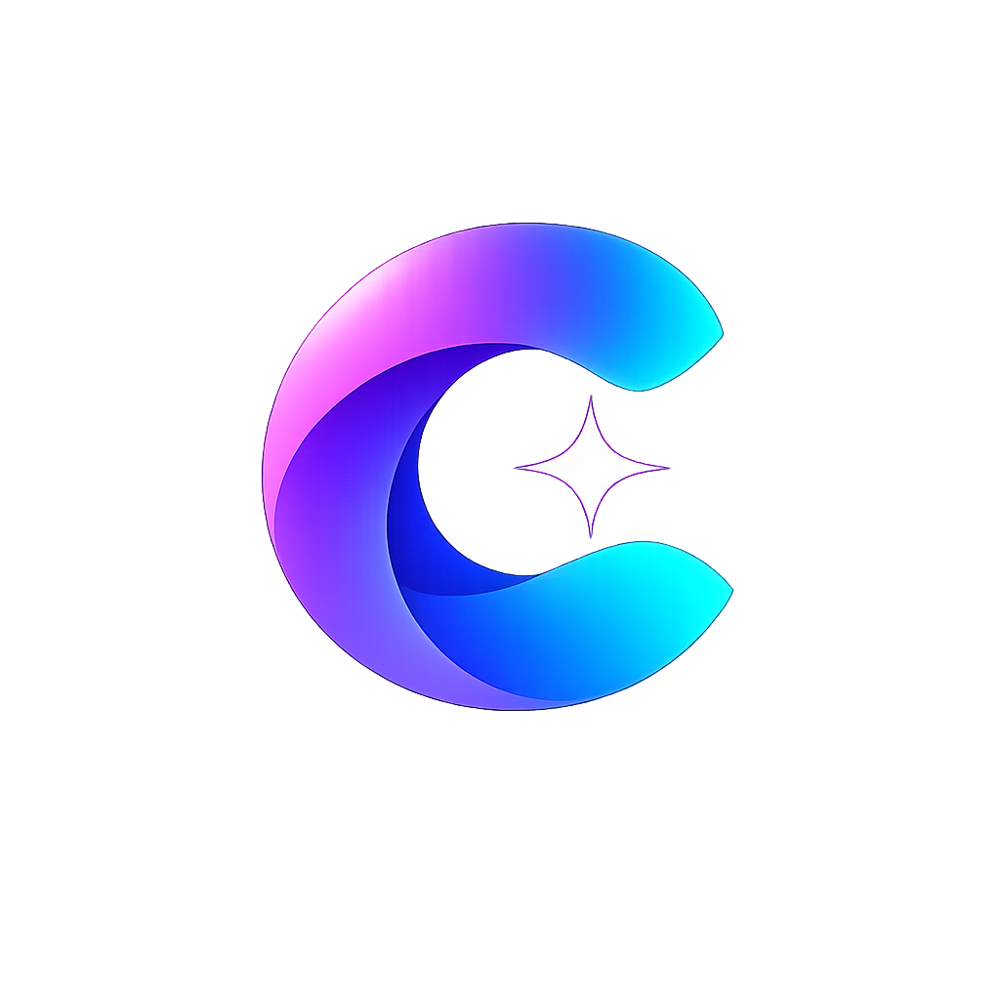

<p align="center">
  
</p>

# Curio — Universal In-Situ AI Browser Extension & Personal Learning Assistant

> **Intelligent, in-situ context comprehension directly in your reading flow.**  
> Built with Chrome Manifest V3, pure JavaScript (ES6+), React 19 + JSX, Tailwind CSS, Vite, and Shadow DOM isolation.

---

## 📖 Overview

**Curio** is a production-grade Chromium extension designed to provide real-time, streaming AI explanations for any selected word, sentence, technical terminology, mathematical expression, or code snippet across virtually any website—without the user ever needing to leave their reading environment or switch tabs.

Curio extends beyond a simple text explainer into an intelligent **Personal Learning Assistant** featuring:
- **Universal Multi-Strategy Text Selection** across SPAs, Shadow DOMs, iframes, code gutters, and inputs.
- **Real-Time Streaming AI Explanations** powered by Google Gemini (`gemini-2.0-flash`) and Groq (`llama-3.3-70b-versatile`) via low-latency Server-Sent Events (SSE).
- **Intelligent Pre-Stream Provider Failover** guaranteeing seamless recovery if primary provider quota is reached.
- **Premium Floating AI Interface** positioned dynamically with collision detection and full Shadow DOM style isolation.
- **Progressive Markdown & Code Syntax Highlighting** with safe client-side parsing (zero raw HTML injection).
- **Personal Learning Hub & Glossary** tracking explored concepts, user comprehension levels, and personal notes.
- **Knowledge Graph Semantic Engine** linking related technical concepts (e.g. `Python map()` $\rightarrow$ `Iterables`, `Lambdas`, `List Comprehensions`).
- **Offline-First & Accountless Architecture** persisting data locally, with an optional Dockerized PostgreSQL backend for multi-device sync.

---

## 🛠️ Technology Stack

- **Platform:** Chromium Extension (Chrome Manifest V3)
- **Language:** JavaScript (ES6+ Modules) with JSDoc type annotations
- **Runtime Validation:** Zod
- **Frontend Core:** React 19 + JSX, Tailwind CSS, Lucide Icons
- **Isolation:** Open Shadow DOM host element (`<curio-host>`) with injected stylesheets
- **Build System:** Vite 6, Rollup multi-input bundling, PostCSS
- **Backend API:** Node.js, Express, Helmet, CORS, Rate Limiting, PostgreSQL 16
- **DevOps:** Docker, Docker Compose, GitHub Actions CI

---

## 📁 Repository Structure

```
curio/
├── ARCHITECTURE.md                  # Comprehensive architectural specification
├── AI_ARCHITECTURE.md               # AI streaming pipeline, factory & orchestration
├── PROVIDER_INTEGRATION.md          # Google Gemini & Groq direct API integrations
├── STREAMING_PROTOCOL.md            # W3C Server-Sent Events wire format specification
├── ERROR_HANDLING.md                # Error taxonomy, pre-stream failover & recovery
├── AI_TEST_REPORT.md                # 129-test comprehensive verification audit
├── TECHNICAL_DECISIONS.md           # Architecture Decision Records (ADRs 001–008)
├── DEVELOPMENT_PLAN.md              # Phased implementation roadmap & WBS
├── COMPATIBILITY.md                 # Cross-platform compatibility & environment audit
├── SECURITY.md                      # Security audit, threat model & PII policies
├── README.md                        # Documentation & setup guide
├── package.json                     # Dependencies, scripts & build pipelines
├── vite.config.js                   # Vite configuration (ES Modules)
├── tailwind.config.js               # Shadow-DOM-ready Tailwind setup
├── postcss.config.js                # PostCSS compilation pipeline
├── docker-compose.yml               # Backend + PostgreSQL Docker stack
│
├── backend/                         # Cloud Sync & AI Streaming Backend
│   ├── Dockerfile                   # Multi-stage Alpine container
│   ├── schema.sql                   # Production PostgreSQL schema & indexes
│   ├── package.json                 # Backend dependencies
│   ├── .env.example                 # Environment variable templates
│   └── src/
│       ├── server.js                # Express API server with Helmet & Rate Limiting
│       ├── app.js                   # Express application setup & middleware
│       ├── db.js                    # PostgreSQL connection pool with healthcheck
│       ├── config/env.js            # Zero-dependency Zod environment validator
│       ├── services/ai/             # AI Provider Abstraction & Pipeline
│       │   ├── aiProviderFactory.js # Dynamic provider registry & failover
│       │   ├── explanationService.js# Stream orchestrator & failover coordinator
│       │   ├── streamingService.js  # SSE session management & abort handler
│       │   ├── promptBuilder.js     # Prompt orchestration & XML isolation
│       │   └── providers/
│       │       ├── geminiProvider.js# Google Gemini 2.0 Flash REST SSE provider
│       │       └── groqProvider.js  # Groq Llama 3.3 70B REST SSE provider
│       └── routes/
│           ├── explain.js           # SSE explanation & follow-up endpoints
│           ├── health.js            # Operational status & provider diagnostics
│           └── learning.js          # Zod-validated sync & glossary endpoints
│
├── public/                          # Static extension assets
│   ├── manifest.json                # Chrome Manifest V3 specification
│   └── icons/                       # Extension icons (16px, 48px, 128px)
│
├── scripts/
│   ├── build.js                     # Two-pass build runner (ESM pages + IIFE content script)
│   ├── generate-icons.js            # Automated PNG icon generator
│   └── package-extension.js         # Production zip builder for Chrome Web Store
│
├── tests/
│   └── unit/
│       ├── selection.test.js        # Selection normalizers, sentence & math tests
│       ├── overlay.test.js          # Viewport collision, dragging & mock explainer
│       ├── learning.test.js         # Glossary persistence, metrics & knowledge graph
│       └── compatibility.test.js    # Cross-site tests (ChatGPT, GitHub, SO, Medium, PDFs)
│
├── popup.html                       # Extension action popup entrypoint
├── options.html                     # Options & Learning Hub entrypoint
│
└── src/
    ├── background/
    │   └── service-worker.js        # MV3 Service Worker (Commands, menus, IPC)
    ├── content/
    │   ├── content-script.js        # Content script coordinator (IIFE bundle)
    │   ├── selection/               # Multi-strategy selection engine
    │   │   ├── standardSelector.js  # window.getSelection() strategy
    │   │   ├── inputSelector.js     # <input> & <textarea> selectionStart/End
    │   │   ├── editableSelector.js  # contenteditable support
    │   │   ├── shadowSelector.js    # Shadow DOM piercing selector
    │   │   ├── codeSelector.js      # Gutter stripping & language detection
    │   │   └── mathSelector.js      # KaTeX / MathJax LaTeX extractor
    │   ├── context/
    │   │   └── index.js             # Semantic block walker, sentence & PII scrubber
    │   └── overlay/
    │       ├── FloatingOverlay.jsx  # Premium React floating AI explanation card
    │       ├── mount.jsx            # Shadow DOM lifecycle & React 19 createRoot
    │       ├── positioning.js       # Viewport collision, flip & drag engine
    │       ├── mockExplainer.js     # Multi-depth contextual explanation generator
    │       └── overlay.css          # Shadow DOM scoped styles & keyframes
    ├── popup/
    │   ├── App.jsx                  # Popup with status & Learning Hub link
    │   └── main.jsx                 # Popup React mount
    ├── options/
    │   ├── App.jsx                  # Options navigation & settings controller
    │   ├── LearningHub.jsx          # Personal Learning Hub & Glossary dashboard
    │   └── main.jsx                 # Options React mount
    └── shared/
        ├── constants/index.js       # Storage keys, command names, restricted URLs
        ├── types/index.js           # Zod runtime schemas & JSDoc contracts
        ├── services/
        │   ├── knowledgeGraph.js    # Semantic relationships & category inference
        │   └── learningService.js   # Personal glossary CRUD & learning metrics
        └── utils/
            ├── storage.js           # Credential-isolated chrome.storage facade
            └── messaging.js         # Resilient IPC messaging
```

---

## 🚀 Getting Started

### Prerequisites
- **Node.js 20+** (v22 LTS recommended)
- **Chromium Browser** (Chrome, Brave, Arc, Edge)

### 1. Installation & Build
```bash
# Clone the repository
git clone https://github.com/your-username/curio.git
cd curio

# Install dependencies
npm install

# Run automated tests (129 passing unit tests)
npm test

# Build production bundles
npm run build
```

### 2. Configure & Run Backend AI Server
```bash
# 1. Install backend dependencies (express, cors, helmet, etc.)
npm run backend:install

# 2. Copy environment configuration and configure your API keys
cp .env.example .env

# 3. Start the Node.js backend server (runs on port 5000)
npm run server
```

### 3. Load into Chrome
1. Open Google Chrome and navigate to `chrome://extensions/`.
2. Enable **Developer mode** using the toggle in the top-right corner.
3. Click **Load unpacked** and select the `/dist` directory inside the Curio project folder.
4. The Curio icon will appear in your browser toolbar.

### 4. Usage Flow
1. Visit any website (e.g., GitHub, Stack Overflow, React Docs, ChatGPT, Medium).
2. Highlight any word, sentence, code snippet, or technical term.
3. Press **`Alt + Shift + E`** (or click the extension icon / right-click "Explain with Curio").
4. A floating dark-mode explanation window appears near your selection:
   - Live stream starts instantly with token-by-token progressive rendering.
   - Toggle explanation depth: **Simple** (analogies), **Intermediate** (technical), or **Advanced** (internals & complexity).
   - View syntax-highlighted code blocks with dedicated copy actions.
   - Explore **Knowledge Connections** linking related concepts.
   - Update your comprehension level (**Understood** or **Review**).
   - Click **Stop** to halt generation at any time, or **Retry** if an upstream error occurs.
   - Ask follow-up questions directly in the bottom input bar.
   - Press **`Esc`** or click the close button to dismiss.

---

## 📚 Personal Learning Hub

Open `chrome://extensions` $\rightarrow$ Curio Details $\rightarrow$ Extension Options (or click "Open Learning Hub" in the extension popup):
- **Personal Glossary:** Browse all explored concepts categorized by topic (`React`, `Python`, `Architecture`, `Algorithms`, etc.).
- **Search & Filter:** Search by keywords, category, understanding rating, or saved status.
- **Revisit Explanations:** Click any concept to reopen its full structured explanation, takeaways, and code snippets.
- **Personal Notes:** Add custom takeaways or caveats directly to any concept.
- **Privacy & Consent:** Export your complete learning history as a formatted `.json` file, or purge your local library at any time.

---

## 🤖 AI Streaming Endpoints & Health Diagnostics

The backend provides low-latency streaming and diagnostic endpoints:
- `POST /api/v1/explain/stream` — W3C Server-Sent Events stream for contextual text explanations.
- `POST /api/v1/explain/follow-up/stream` — Conversational follow-up question streaming.
- `GET /api/v1/health` — Service health and provider readiness diagnostics.

```bash
# Check provider readiness and service status
curl http://localhost:5000/api/v1/health
```

---

## 🐳 Backend Cloud Synchronization (Docker)

To run the optional PostgreSQL sync backend:

```bash
# Start backend and database services
docker compose up -d

# Verify health status
curl http://localhost:5000/health
```

The server provides:
- `POST /api/v1/learning/sync` — Bulk upsert of glossary items from extension.
- `GET /api/v1/learning/concepts` — Retrieve synchronized concept history.
- `DELETE /api/v1/learning/user/data` — User-initiated data purge (GDPR / privacy compliance).

---

## 🧪 Testing & Verification

Curio maintains a comprehensive test suite executed natively using `node:test`:

```bash
# Run all 129 unit, AI provider, streaming and compatibility tests
npm test
```

### Test Coverage Highlights:
- **AI Providers & Factory:** Validates Google Gemini 2.0 Flash, Groq Llama 3.3 70B, error normalization, and pre-stream failover.
- **SSE Streaming Pipeline:** Validates W3C event encoding, arbitrary TCP chunk reassembly, and client abort propagation.
- **Code Gutter Normalization:** Validates stripping leading digits and tab gutters from GitHub and Stack Overflow.
- **Copy Button Stripping:** Validates removing ChatGPT, Claude, and GitHub copy button artifacts.
- **Viewport Positioning:** Tests vertical collision, automatic flip above selection, horizontal clamping, and boundary dragging.
- **Knowledge Graph:** Validates relationship mappings (e.g. `Python map` $\rightarrow$ `Iterables`, `Lambdas`, `List Comprehensions`).
- **Security & Privacy:** Verifies password input rejection, URL token stripping, and restricted URL rejection.

---

## 📦 Packaging for Chrome Web Store

To build a production-ready `.zip` package for the Chrome Web Store Developer Dashboard:

```bash
npm run package
```

The script verifies Manifest V3 compliance, validates required icons and entrypoints, scans for forbidden development files, and outputs `curio-extension-v1.0.0.zip`.

---

## 🔒 Security & Privacy Posture

- **Zero Client Secrets:** LLM API keys (Gemini, Groq) reside exclusively in the server `.env` file and are never sent to the browser or stored in `chrome.storage`.
- **Zero Content Scripts DOM Leaks:** All overlay UI elements are mounted into an isolated Shadow DOM (`<curio-host>`), preventing style bleeding or host-page interference.
- **Strict Least-Privilege Manifest:** Requests only `storage`, `activeTab`, and `contextMenus`. No invasive browsing history permissions.
- **Full Details:** See [`SECURITY.md`](SECURITY.md) and [`COMPATIBILITY.md`](COMPATIBILITY.md).

---

## 📄 License

MIT License. Designed and built with modern Chromium extension engineering best practices.
