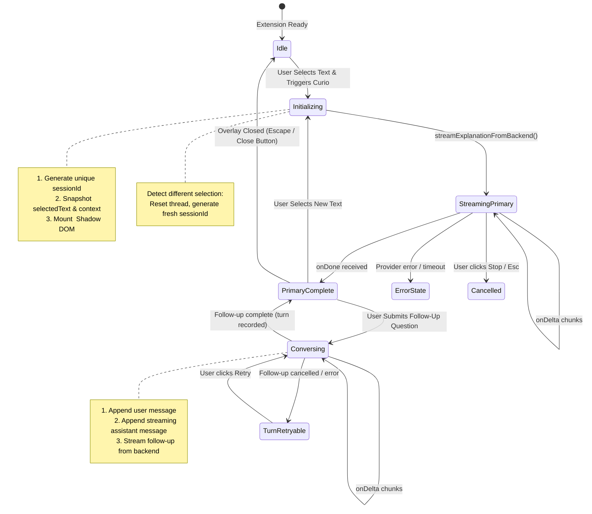

# Curio — Session Management & Conversation Isolation Architecture

> **Deterministic Session Lifecycles, Multi-Turn Memory Boundaries, and Cross-Explanation Isolation**  
> Built with Chrome Manifest V3, Pure JavaScript ES Modules, React 19, and Node.js.

---

## 1. Overview & Purpose

In-situ contextual learning requires strict session isolation. When a user highlights `React useEffect`, explores a multi-turn conversation, and subsequently highlights `CSS Grid`, the system must:
1. Preserve conversational context throughout all follow-ups for `React useEffect`.
2. Prevent context bleeding between different selections.
3. Automatically initialize a brand-new, isolated session when a distinct selection occurs.
4. Protect against memory leaks and unbounded state accumulation.

The **Curio Session Management Engine** (`sessionManager.js`) provides this deterministic lifecycle.

---

## 2. Session Schema Specification

Every active explanation session is represented by a standardized JavaScript object:

```javascript
/**
 * @typedef {Object} ExplanationSession
 * @property {string} sessionId - Cryptographically unique session identifier (e.g. curio_sess_m3a9j1_k9z2)
 * @property {string} selectedText - Exact text selected by user on webpage
 * @property {string} surroundingContext - Paragraph or block containing selection
 * @property {string} surroundingSentence - Immediate sentence containing selection
 * @property {string} pageTitle - Title of active webpage
 * @property {string} pageUrl - Sanitized URL of active webpage
 * @property {string} contentType - 'programming_code' | 'technical_terminology' | 'mathematical_expression' | 'abbreviation' | 'general_text'
 * @property {string} selectionType - 'word' | 'sentence' | 'paragraph' | 'multi_paragraph' | 'code' | 'math'
 * @property {string|null} language - Programming language if applicable
 * @property {string} explanationLevel - 'beginner' | 'intermediate' | 'advanced'
 * @property {string} provider - 'gemini' | 'groq' | 'local'
 * @property {string|null} model - Specific AI model identifier
 * @property {number} createdAt - Epoch millisecond timestamp of session creation
 * @property {number} updatedAt - Epoch millisecond timestamp of last interaction
 * @property {string} initialExplanation - Full primary explanation generated
 * @property {string} initialStatus - 'loading' | 'streaming' | 'completed' | 'error' | 'cancelled'
 * @property {Array<ConversationMessage>} messages - Ordered array of follow-up exchanges
 * @property {string} summary - Condensed summary of older turns once thread exceeds 8 turns
 */

/**
 * @typedef {Object} ConversationMessage
 * @property {string} id - Unique turn identifier (e.g. msg_m3a9j2_7f1a)
 * @property {'user'|'assistant'} role - Sender role
 * @property {string} content - Markdown text content
 * @property {number} timestamp - Turn creation timestamp
 * @property {'streaming'|'completed'|'error'|'cancelled'} status - Turn generation state
 * @property {string|null} [error] - Error message if status === 'error'
 */
```

---

## 3. Session Identifier (`sessionId`) Generation

Session IDs are generated using combined epoch millisecond base-36 encodings and pseudo-random entropy:

```javascript
export function generateSessionId() {
  const timestamp = Date.now().toString(36);
  const randomPart = Math.random().toString(36).substring(2, 10);
  return `curio_sess_${timestamp}_${randomPart}`;
}
```

### Properties
- **Collision-free**: Timestamp prefix guarantees ordering and temporal uniqueness across tabs.
- **Traceable**: Logs and backend traces match frontend requests via `sessionId`.
- **Ephemeral**: Does not expose browser fingerprinting data or personal user identifiers.

---

## 4. Session State Machine & Lifecycle Transitions



---

## 5. Cross-Selection Isolation (`isSameSelectionSession`)

To guarantee that follow-ups never corrupt or blend separate reading tasks:

```javascript
export function isSameSelectionSession(activeSession, newContext) {
  if (!activeSession || !activeSession.selectedText) return false;
  if (!newContext) return false;

  const newText = (newContext.selectedText || newContext.text || '').trim();
  if (!newText) return false;

  // Exact normalized match
  return activeSession.selectedText === newText;
}
```

### Behavior Matrix
| Current Session Text | New Incoming Context | Action Taken |
| :--- | :--- | :--- |
| `"Python map()"` | `"Python map()"` | Preserves existing session, thread, and memory. |
| `"Python map()"` | `"Python filter()"` | **Aborts** active streams, creates fresh `sessionId`, wipes previous thread, mounts new explanation. |
| `"Python map()"` | `""` (Empty/deselected) | Keeps existing session open without resetting. |
| `"Python map()"` | `"Python map()"` (Retrigger) | Preserves existing conversation, brings overlay into focus. |

---

## 6. Memory Limits & Bounded Memory Window

LLM contexts have finite context windows and proportional token pricing. Unconstrained multi-turn chat risks latency degradation and token exhaustion.

Curio solves this via a **Hybrid Sliding Window + Summarization Model**:

```
[ Turn 1: Q&A ] ──┐
[ Turn 2: Q&A ]   ├── Condensed into <earlier_conversation_summary>
[ Turn 3: Q&A ] ──┘
───────────────────────────────────────────────────────────────
[ Turn 4: User Question ]       ▲
[ Turn 4: Assistant Answer ]    │ Verbatim Sliding Window
[ Turn 5: User Question ]       │ (Last 4–6 messages)
[ Turn 5: Assistant Answer ]    ▼
───────────────────────────────────────────────────────────────
[ Current Follow-Up Question ]  → Sent to Gemini / Groq
```

### Sliding Window Execution
- **Under 6 turns**: Entire conversation history is passed verbatim to the LLM.
- **Above 6 turns**: Older turns are summarized into concise bullet points (`- Q: "..." → A: ...`), and only the last 4 turns are passed verbatim.
- **Original Selection Anchor**: The original `selectedText` is **never pruned**, remaining the unshakeable focal point of all answers.

---

## 7. Persistence & Data Hygiene

- **Session Isolation in Storage**: Active conversation turns are stored solely in memory (`sessionRef.current`) during the lifetime of the overlay.
- **Learning Hub Saving**: If the user clicks the **Bookmark** action, the concept is permanently indexed in `chrome.storage.local` under the `curio_learning_concepts_v1` key, tracking understanding rating, review flags, and definition summary.
- **Automatic Garbage Collection**: Unsaved conversational threads are automatically dereferenced when the floating interface unmounts or switches selections, leaving zero persistent memory footprint on the client machine.

