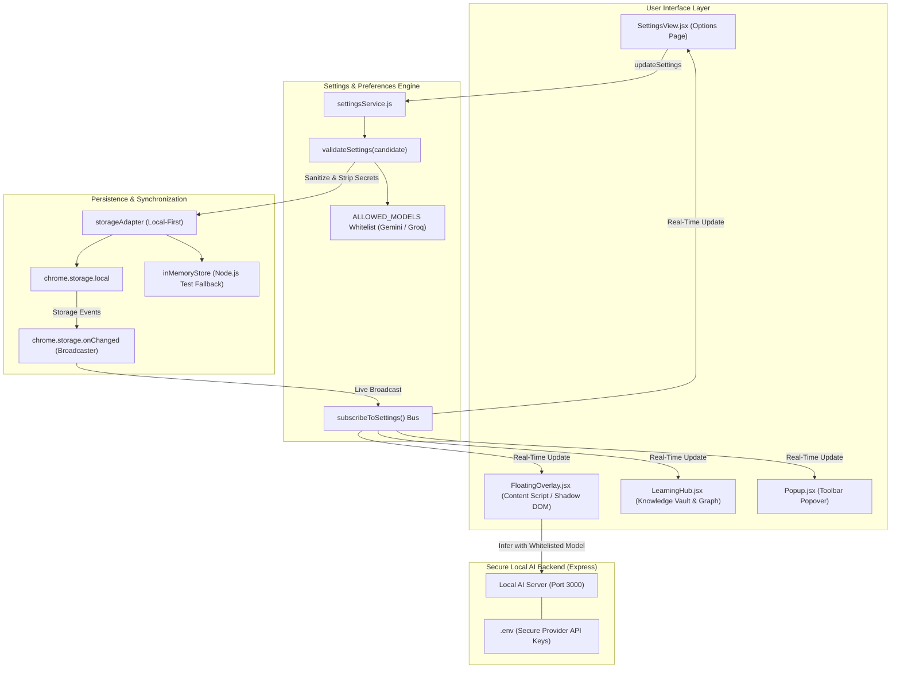

# Curio — Settings, Preferences and Personalization Architecture

## 1. Overview & Objectives

The **Curio Settings & Personalization Engine** establishes a centralized, robust, and privacy-first preference system for the Curio Chrome extension. It unifies user controls across 5 core dimensions:
1. **General Interface Settings** (Theme, Language, Depth, Window Behavior, Animations)
2. **AI & Intelligence Models** (Provider selection, Whitelisted models, Response detail, Cancellation behavior)
3. **Keyboard Shortcuts** (Manifest V3 native shortcut introspection and deep-linking)
4. **Privacy, History & Data Sovereignty** (History logging, local retention, granular and complete erasure, full JSON backup)
5. **Appearance & UI Density** (Theme mode, Compact layout, Floating overlay width, Typography base scale)

The architecture is built strictly with **100% pure JavaScript (ES6+ / React 19 JSX)**, adheres strictly to **Chrome Manifest V3**, guarantees **Zero API Key Exposure** within the browser sandbox, and maintains instantaneous cross-component state synchronization via `chrome.storage.onChanged`.

---

## 2. Architectural Blueprint



---

## 3. Settings Categories & Specification

### Category 1: General Settings
* **Theme (`theme`)**: `'dark'` | `'light'` | `'system'` (Default: `'system'`). Determines color scheme across options, popup, and floating overlay.
* **Interface Language (`language`)**: `'en'` | `'es'` | `'fr'` | `'de'` | `'zh'` | `'ja'` | `'hi'` (Default: `'en'`). Configures extension interface strings and localization prompts.
* **Default Explanation Level (`defaultLevel`)**: `'beginner'` | `'intermediate'` | `'advanced'` (Default: `'intermediate'`). Controls default depth when newly explaining highlighted text.
* **Window Behavior (`windowBehavior`)**:
  * `'near_selection'`: Dynamically calculates screen viewport bounding box near highlighted text with boundary clamping.
  * `'remember_last'`: Retains user's last dragged overlay position across sessions.
  * `'top_right'`: Fixed anchor 24px from top-right of viewport.
  * `'center'`: Centered viewport modal overlay.
* **Animation Preference (`animationPreference`)**: `'full'` | `'reduced'` | `'disabled'` (Default: `'full'`). When `'disabled'`, eliminates CSS transitions and enter animations for accessibility and low-spec systems.

### Category 2: AI & Intelligence Models
* **Default Provider (`aiProvider`)**: `'gemini'` | `'groq'` (Default: `'gemini'`).
* **Allowed Model Selection (`model`)**:
  * **Gemini Models**: `'gemini-2.0-flash'`, `'gemini-1.5-pro'`, `'gemini-1.5-flash'`.
  * **Groq Models**: `'llama-3.3-70b-versatile'`, `'llama-3.1-8b-instant'`, `'mixtral-8x7b-32768'`.
  * **Strict Security Enforcement**: Unapproved or arbitrary model names (e.g. prompt injection attempts, invalid models) are automatically rejected by `validateSettings()` and reverted to `ALLOWED_MODELS[provider][0]`.
* **Zero API Key Exposure Guarantee**: Provider API keys (`GEMINI_API_KEY`, `GROQ_API_KEY`) reside exclusively in the backend server's `.env` environment. Extension settings never request, store, or transmit raw API keys. Any `apiKey` field passed to `validateSettings()` is automatically stripped.
* **Response Detail Preference (`responseDetail`)**: `'concise'` | `'standard'` | `'comprehensive'` (Default: `'standard'`). Shapes system instructions sent to backend SSE routes.
* **Generation Cancellation Behavior (`cancellationBehavior`)**:
  * `'keep_partial'` (Default): Preserves streamed text received up to the cancellation point, accompanied by a status notice.
  * `'discard_cancelled'`: Clears streaming card buffer on user cancel or abort.

### Category 3: Keyboard Shortcuts
* **Display Active Shortcut (`shortcut`)**: Shows current hotkey registered in Manifest (`Alt+Shift+E`).
* **Manifest V3 Compliant Rebinding**: Chromium security strictly prohibits extensions from overriding or hijacking global operating system / browser shortcuts via arbitrary DOM event listeners. Curio directs users to Chrome's native shortcuts manager (`chrome://extensions/shortcuts`) using `chrome.tabs.create`.

### Category 4: Privacy, History & Data Sovereignty
* **Save Exploration History (`saveHistory`)**: Boolean (Default: `true`). When false, concept exploration is not added to the local learning glossary or graph.
* **Auto-Save Explanations to Vault (`autoSaveBookmarks`)**: Boolean (Default: `false`). Automatically saves generated explanations directly into Knowledge Vault without requiring bookmark clicks.
* **Local Retention Window (`localRetentionDays`)**: `0` (indefinite) | `30` | `90` | `365` days.
* **Granular Deletion Controls**:
  * `clearConversationHistory()`: Resets active follow-up conversation threads and session cache (`curio_active_session_v1`).
  * `clearSavedExplanations()`: Wipes saved concepts and collections from Knowledge Vault (`curio_vault_concepts_v1`, `curio_vault_collections_v1`).
* **Complete Personal Erasure (`clearAllPersonalData()`)**: Permanent deletion modal requiring explicit confirmation. Wipes vault, glossary, graph edges, goals, and resets settings to defaults.
* **Personal Data Export (`exportAllPersonalData()`)**: Generates structured, versioned JSON backup containing settings, concepts, collections, glossary items, graph relationships, and learning goals.

### Category 5: Appearance & UI Density
* **Compact Interface Mode (`compactMode`)**: Boolean (Default: `false`). Compresses padding and card margins across UI.
* **Floating Overlay Width (`overlayWidth`)**:
  * `'compact'`: 380px (minimal screen intrusion).
  * `'standard'`: 450px (balanced typography and reading comfort).
  * `'wide'`: 540px (optimal for long code blocks and side-by-side examples).
* **Typography Base Scale (`fontSize`)**: `'small'` (11px base) | `'medium'` (13px base) | `'large'` (14px base).

---

## 4. Data Model & Schema Definition

```javascript
export const AppSettingsSchema = z.object({
  // General Settings
  theme: z.enum(['light', 'dark', 'system']).default('system'),
  language: z.enum(['en', 'es', 'fr', 'de', 'zh', 'ja', 'hi']).default('en'),
  defaultLevel: z.enum(['beginner', 'intermediate', 'advanced']).default('intermediate'),
  windowBehavior: z.enum(['near_selection', 'remember_last', 'top_right', 'center']).default('near_selection'),
  animationPreference: z.enum(['full', 'reduced', 'disabled']).default('full'),

  // AI & Models
  aiProvider: z.enum(['gemini', 'groq']).default('gemini'),
  apiKey: z.string().default(''),
  model: z.string().default('gemini-2.0-flash'),
  responseDetail: z.enum(['concise', 'standard', 'comprehensive']).default('standard'),
  cancellationBehavior: z.enum(['keep_partial', 'discard_cancelled']).default('keep_partial'),

  // Keyboard Shortcuts
  shortcut: z.string().default('Alt+Shift+E'),

  // Privacy & Retention
  saveHistory: z.boolean().default(true),
  autoSaveBookmarks: z.boolean().default(false),
  localRetentionDays: z.number().default(0),

  // Appearance & Density
  compactMode: z.boolean().default(false),
  overlayWidth: z.enum(['compact', 'standard', 'wide']).default('standard'),
  fontSize: z.enum(['small', 'medium', 'large']).default('medium'),

  // Backwards Compatibility
  explanationStyle: z.enum(['concise', 'detailed', 'simple']).default('concise'),
  enabled: z.boolean().default(true),
  showFloatingButton: z.boolean().default(true),
  contextWindowSize: z.number().min(100).max(1000).default(500),
});
```

---

## 5. Live Cross-Component Synchronization

In Manifest V3, extension contexts (options page, popup, background service worker, and content scripts injected into browser tabs) run in isolated JavaScript runtimes.

Curio solves cross-context synchronization using `subscribeToSettings(callback)`:
1. When any component calls `updateSettings(partial)`, `chrome.storage.local.set` persists the validated schema.
2. Chromium dispatches `chrome.storage.onChanged` to all extension execution contexts.
3. Content script overlays and popup views receive the change event without needing full tab refreshes or extension reloads.
4. If running in a Node.js test runner or non-extension environment, an in-memory listener set acts as a zero-dependency event bus.

---

## 6. Security & Privacy Guarantees

| Security Requirement | Implementation Mechanism |
|---|---|
| **Zero Credential Exposure** | API keys never enter `chrome.storage.local` or client bundles. `validateSettings()` forcibly sanitizes keys. All LLM requests execute via local Express server. |
| **Model Injection Prevention** | Models are checked against `ALLOWED_MODELS`. Arbitrary strings fallback to `ALLOWED_MODELS[provider][0]`. |
| **Local-First Sovereignty** | 100% of user settings, vault entries, glossary, and graphs remain in `chrome.storage.local`. No external tracking or telemetry is executed. |
| **Complete Erasure** | `clearAllPersonalData()` wipes all storage keys and resets settings to factory defaults. |
