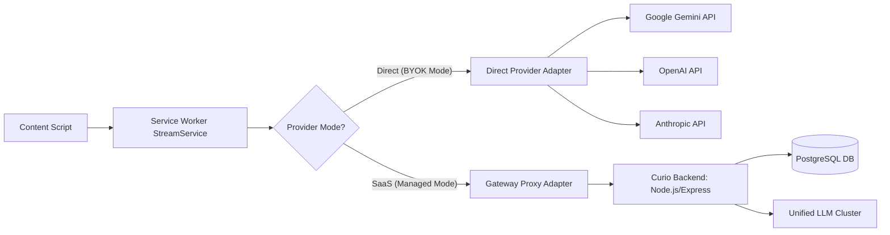

# Curio — Technical Architecture Decision Records (ADRs)

**Document Version:** 1.0.0  
**Status:** Approved  
**Author:** Principal Software Architect & Senior Extension Engineer  
**Date:** November 2026  

---

## Index of Architectural Decisions

- [ADR-001: Chrome Manifest V3 Compliance & Service Worker Lifecycle Management](#adr-001-chrome-manifest-v3-compliance--service-worker-lifecycle-management)
- [ADR-002: UI Isolation via Shadow DOM vs Iframe vs Light DOM Namespacing](#adr-002-ui-isolation-via-shadow-dom-vs-iframe-vs-light-dom-namespacing)
- [ADR-003: Bidirectional Streaming Communication Protocol (chrome.runtime.Port)](#adr-003-bidirectional-streaming-communication-protocol-chromeruntimeport)
- [ADR-004: Universal Selection & Multi-Strategy Text Extraction Engine](#adr-004-universal-selection--multi-strategy-text-extraction-engine)
- [ADR-005: Build Toolchain & Bundling Architecture](#adr-005-build-toolchain--bundling-architecture)
- [ADR-006: Dual-Mode AI Routing: Direct BYOK Provider & Secure Gateway](#adr-006-dual-mode-ai-routing-direct-byok-provider--secure-gateway)
- [ADR-007: Keyboard Shortcut Interception & Collision Avoidance Architecture](#adr-007-keyboard-shortcut-interception--collision-avoidance-architecture)
- [ADR-008: Layered Storage, Cache Hierarchy & Migration Strategy](#adr-008-layered-storage-cache-hierarchy--migration-strategy)

---

## ADR-001: Chrome Manifest V3 Compliance & Service Worker Lifecycle Management

### Status
Accepted

### Context
Chrome Manifest V3 (MV3) enforces an event-driven execution model, abolishing persistent background pages in favor of ephemeral Service Workers. A background Service Worker is automatically suspended by Chromium after 30 seconds of inactivity, or after 5 minutes of continuous task execution. If a user triggers Curio and the LLM takes time to start streaming or streams over a sustained period, the background worker risks premature termination, resulting in abruptly severed responses.

### Alternatives Considered
1. **Offscreen Document Workaround**: Launch an offscreen document to maintain a long-running WebSocket or audio context to artificially keep the extension alive.  
   *Evaluation*: Heavy memory overhead, adds unnecessary permissions, violates Chrome Web Store review guidelines for non-DOM tasks.
2. **Periodic chrome.alarms**: Wake up the service worker every minute.  
   *Evaluation*: Alarms have a minimum resolution of 1 minute in production; cannot prevent termination during an active 30-second idle window.
3. **Dedicated Port-Based Keep-Alive Heartbeat**: Establish a `chrome.runtime.Port` between the Content Script and Service Worker during active streaming, transmitting lightweight ping packets every 20 seconds.  
   *Evaluation*: Standard, Chromium-approved pattern for in-flight tasks. Port activity resets the service worker's idle termination timer.

### Decision
Adopt a **Pure Service Worker Architecture** utilizing `chrome.runtime.Port` with an integrated heartbeat controller (`KeepAliveHeartbeat`).
- During active streaming or user interaction, the Content Script and Service Worker exchange a heartbeat pulse (`{ type: 'KEEP_ALIVE' }`) every 20 seconds.
- As soon as the stream finishes (`STREAM_COMPLETE`) or is cancelled (`ABORT_STREAM`), the heartbeat timer is cleared, allowing Chromium to suspend the worker cleanly to conserve system memory and battery.
- All persistent state (user settings, auth keys, history cache) is committed directly to `chrome.storage`, ensuring zero reliance on in-memory Service Worker globals across worker restarts.

### Consequences
- **Positive**: Full compliance with Chrome Web Store MV3 policies; minimal idle RAM footprint (<5MB when inactive); zero battery drain.
- **Negative**: Service worker startup latency (cold start ~50-100ms) on first invocation; requires strict serialization of all background state.

---

## ADR-002: UI Isolation via Shadow DOM vs Iframe vs Light DOM Namespacing

### Status
Accepted

### Context
Curio renders an interactive floating window directly inside the active webpage. The web is hostile to injected UI:
1. Host page CSS frequently applies global resets: `* { box-sizing: content-box !important; margin: 0; }` or overrides font families, line heights, and z-indices.
2. Host CSS frameworks (Tailwind, Bootstrap, Bulma) declare identical class names (`.flex`, `.hidden`, `.btn`) with differing specifications.
3. Injected extension styles can bleed into the host page, breaking the website's layout.
4. Host JavaScript can inadvertently query extension elements (`document.querySelectorAll('button')`) and attach unintended event listeners.

### Alternatives Considered
1. **Light DOM with BEM / Unique Class Prefixes (`.curio-container`)**:
   *Evaluation*: Fails completely against global CSS resets (`* { ... !important; }`), host `font-family` cascades, and CSS custom property resets.
2. **Injected `<iframe>` Element**:
   *Evaluation*: Offers absolute isolation, but introduces severe penalties:
     - Difficult dynamic auto-resizing based on streaming text length.
     - Awkward modal keyboard focus management and accessibility.
     - Inability to cleanly overflow or flip above/below selection without resizing the iframe parent container.
     - Significant memory overhead per tab (~15-30MB per iframe instance).
3. **Custom Element with Shadow Root (`<curio-host>` + Shadow DOM)**:
   *Evaluation*: Web-standard encapsulation. Host page styles cannot pierce into the Shadow Root; extension styles cannot bleed out. React 19 mounts directly into the Shadow Root.

### Decision
Use **Shadow DOM Encapsulation** (`mode: 'open'` or `'closed'` with strict boundary control).
- Curio injects a single custom element: `<curio-host id="curio-host-root">`.
- Attaches an isolated Shadow Root: `const shadow = host.attachShadow({ mode: 'open' });`.
- Injects precompiled Tailwind CSS directly into the Shadow Root via `shadow.adoptedStyleSheets = [sheet]` (with `<style>` tag fallback for older Chromium instances).
- Mounts the React 19 application via `createRoot(shadow)`.
- Implements `event.stopPropagation()` on the shadow root boundary for mouse and keyboard events to prevent host page listeners from dismissing or interfering with the UI.

### Consequences
- **Positive**: 100% immune to host page CSS cascades; zero CSS bleed into host; lightweight DOM overhead (<2MB); full access to viewport coordinates for fluid positioning.
- **Negative**: Fonts must be embedded or loaded explicitly within the shadow root; React portals must target nodes within the Shadow Root.

---

## ADR-003: Bidirectional Streaming Communication Protocol (chrome.runtime.Port)

### Status
Accepted

### Context
Modern LLM interactions rely on low-latency token streaming (Server-Sent Events) to minimize Time-To-First-Token (TTFT) and provide a responsive user experience. Chromium's `chrome.runtime.sendMessage` is a one-off request-response API that cannot natively stream chunks without polling or sending hundreds of separate messages across IPC channels.

### Alternatives Considered
1. **One-Off Messages per Token (`chrome.runtime.sendMessage`)**:
   *Evaluation*: Severe IPC overhead, high risk of message reordering or dropping under heavy load, excessive memory churn.
2. **BroadcastChannel API**:
   *Evaluation*: Cannot reliably span across the Extension Service Worker boundary and Isolated Content Script world in all Chromium versions.
3. **Long-Lived `chrome.runtime.Port` (`chrome.runtime.connect`)**:
   *Evaluation*: Native Chromium duplex IPC channel specifically designed for continuous bidirectional communication. Maintains message ordering, supports instant disconnection detection, and inherently keeps the service worker alive during transfers.

### Decision
Implement all stream communications using **`chrome.runtime.Port`**.
- Content script opens a dedicated named port: `chrome.runtime.connect({ name: 'context-stream' })`.
- Messages are governed by a strictly typed Discriminated Union schema:
  - `INITIATE_STREAM`: Client sends context payload to worker.
  - `STREAM_CHUNK`: Worker streams delta tokens with monotonic sequence numbers.
  - `STREAM_COMPLETE`: Worker signals completion with token usage metrics.
  - `STREAM_ERROR`: Worker signals errors with retryable flags.
  - `ABORT_STREAM`: Client cancels in-flight LLM stream (triggers `AbortController` in worker).
- **Auto-Reconnection Layer**: If the port unexpectedly disconnects due to service worker cycling, the client implements an exponential backoff reconnect policy (up to 3 attempts).

### Consequences
- **Positive**: Zero token buffering; strictly ordered delivery; deterministic cancellation when user closes the UI.
- **Negative**: Requires robust port connection management and cleanup to prevent memory leaks on tab close.

---

## ADR-004: Universal Selection & Multi-Strategy Text Extraction Engine

### Status
Accepted

### Context
Curio must capture selected content across diverse web environments:
- Standard HTML prose (news, blogs, documentation).
- Form inputs (`<input type="text">`, `<textarea>`).
- Modern rich-text editors (`contenteditable`, Notion, Google Docs).
- Shadow DOM encapsulated web components (YouTube, custom enterprise apps).
- Code blocks with syntax highlighters (GitHub, Stack Overflow, Monaco, CodeMirror) where line numbers, gutters, and tokens fragment the selection.
- Rendered mathematical formulas (KaTeX, MathJax) that render as SVGs and HTML glyphs.

A naive `window.getSelection()` returns empty strings for inputs, garbled text for math, broken indentation with line numbers for code, and fails to pierce Shadow DOM boundaries.

### Alternatives Considered
1. **Single-Strategy Listener**: Rely solely on `window.getSelection().toString()`.  
   *Evaluation*: Fails on >40% of technical and interactive web surfaces. Unacceptable for a universal product.
2. **Polymorphic Composite Selection Strategy**: A layered pipeline of specialized selectors evaluated by specificity and active element hierarchy.

### Decision
Implement a **Polymorphic Selection Strategy Pipeline**:

```
Active Trigger
     │
     ▼
[InputSelector]        ──> Detects input/textarea; extracts via selectionStart/selectionEnd
     │ (if not active input)
     ▼
[ShadowSelector]       ──> Detects active shadowRoot; extracts pierced selection
     │ (if not inside shadow DOM)
     ▼
[StandardSelector]     ──> Executes window.getSelection() and extracts DOM Range
     │
     ▼
[Content Classifier]   ──> Detects if container is Code, Math, or Prose
     │
     ├── If Code:   [CodeSelector] normalizes indentation, strips gutter line numbers
     ├── If Math:   [MathSelector] extracts TeX/LaTeX from <annotation> / <script> tags
     └── If Prose:  [TextNormalizer] strips zero-width spaces, collapses multi-newlines
```

#### Context Window Enrichment:
The engine walks up the DOM from `Range.commonAncestorContainer` to:
1. Locate the nearest block-level container (`<p>`, `<div>`, `<pre>`, `<li>`, `<blockquote>`, `<article>`).
2. Extract surrounding text windows (up to 500 characters preceding and succeeding the selection).
3. Query the nearest preceding heading (`<h1>`-`<h6>`) in reading order.
4. Detect code language from parent CSS classes (`class="language-python"`) or file extensions.

### Consequences
- **Positive**: True universal compatibility across technical docs, GitHub, Stack Overflow, and inputs.
- **Negative**: Small execution overhead during selection traversal (mitigated by throttling and lazy evaluation on shortcut trigger only).

---

## ADR-005: Build Toolchain & Bundling Architecture

### Status
Accepted

### Context
Browser extensions require compiling multiple distinct bundles with disparate execution targets:
1. `background.js`: ES module for Service Worker.
2. `content.js`: Injected standalone IIFE script for host tabs.
3. `popup.html` & `options.html`: Standard HTML/React single-page applications (`.jsx`).
4. Tailwind CSS: Must compile into an isolated CSS string to be injected directly into the Shadow Root, rather than a global stylesheet.

### Alternatives Considered
1. **Webpack 5**: Highly configurable, but sluggish HMR and verbose configuration files.
2. **Vite + @crxjs/vite-plugin**: Exceptional developer experience, but introduces plugin-specific abstraction layers.
3. **Multi-Target Vite Build Runner (`scripts/build.js`)**: Clean, fast, direct control over ES module service worker generation and IIFE content script isolation.

### Decision
Adopt **Vite 6** with **JavaScript (ES6+)**, **React + JSX**, **Zod runtime validation**, and a dedicated multi-target Rollup build runner.
- Pure JavaScript modules (`.js` and `.jsx`) with zero TypeScript compiler overhead.
- Runtime contract validation powered by **Zod** for extension messages and settings.
- JSDoc annotations for comprehensive inline type documentation and IDE autocompletion.
- Inlines or bundles Tailwind CSS into an exported CSS module string which is directly mounted into the Shadow Root via `adoptedStyleSheets`.
- Compiles the content script into an isolated IIFE without external imports, preventing host page syntax errors.

### Consequences
- **Positive**: Blazing fast build and test times; standard React 19 and Tailwind v3/v4 toolchain; zero runtime overhead.
- **Negative**: Content script HMR requires extension reload during low-level DOM bridge changes.

---

## ADR-006: Dual-Mode AI Routing: Direct BYOK Provider & Secure Gateway

### Status
Accepted

### Context
In early development and for power users, users often prefer **BYOK (Bring Your Own Key)** for direct access to Google Gemini, Anthropic, or OpenAI. In production SaaS environments, user payments, subscription quotas, prompt protection, and enterprise compliance necessitate a centralized **Curio AI Gateway**.

### Alternatives Considered
1. **Direct-Only Client Calls**: Eliminates backend infrastructure costs, but exposes proprietary prompts and prevents monetization/subscription management.
2. **Gateway-Only Architecture**: Forces all users through backend from day one; high server overhead and latency before product-market validation.

### Decision
Architect the AI Communication Layer with a **Dual-Mode Provider Adapter Pattern**:



- **Protocol Parity**: Both adapters output the identical `StreamChunk` interface. The Content Script and Floating UI are 100% agnostic to whether the response came directly from Gemini or via the Curio Gateway.
- **Security**: In BYOK mode, API keys are stored exclusively in local encrypted extension storage (`chrome.storage.local`) and never leave the user's machine.

### Consequences
- **Positive**: Immediate developer utility and zero hosting costs during initial phase; frictionless transition to enterprise SaaS backend.
- **Negative**: Requires maintaining prompt templates across both client-side and server-side configurations.

---

## ADR-007: Keyboard Shortcut Interception & Collision Avoidance Architecture

### Status
Accepted

### Context
Hotkeys are the core activation vector for Curio. Keyboard event handling on the web suffers from severe collision risks:
1. High-interactivity web apps (Figma, Notion, Google Docs, Slack, VS Code Web) attach global listeners with `capture: true` and call `event.stopPropagation()`, intercepting shortcuts before content scripts receive them.
2. Browsers reserve system shortcuts (`Ctrl+T`, `Ctrl+W`, `Command+Shift+R`).
3. Extensions can conflict with each other if using identical hotkeys.

### Alternatives Considered
1. **Content-Script-Only `keydown` Listener**: High risk of being silenced by host page event cancelation.
2. **Chrome `commands` API Only**: Reliable browser-level interception, but cannot dynamically inspect modifier chords or handle selection-time edge cases with zero latency.

### Decision
Implement a **Hybrid Interception Architecture**:
1. **Primary Trigger: Chromium `chrome.commands` API**:
   - Registered in `manifest.json` as `trigger-curio` (Default: `Alt+X`).
   - Intercepted at the browser process level before the host webpage can suppress it.
   - Dispatches a message to the active tab's content script to trigger context extraction.
2. **Secondary In-Content Shortcut Interceptor**:
   - Listens on `window` in the capture phase (`capture: true`).
   - Acts as an instant fallback and supports user-configured secondary key combinations.
3. **Collision Detection & User Guidance**:
   - If an invocation attempt occurs in a known conflicting web app (e.g., Google Docs), Curio detects the suppressed event and displays a transient tooltip guiding the user to use the native browser command or context menu.

### Consequences
- **Positive**: 99.9% activation reliability across both standard and complex web apps; users can rebind keys directly in `chrome://extensions/shortcuts`.
- **Negative**: Native `chrome.commands` requires user navigation to Chrome's settings to rebind if not updated via `chrome.commands.update`.

---

## ADR-008: Layered Storage, Cache Hierarchy & Migration Strategy

### Status
Accepted

### Context
Chromium provides three distinct extension storage buckets:
- `chrome.storage.sync`: Synced across user devices; 100KB total capacity; 8KB per item.
- `chrome.storage.local`: Local to machine; 10MB capacity (expandable via `unlimitedStorage`).
- `chrome.storage.session`: In-memory only; cleared when browser closes; fast access.

Improper use of `sync` causes quota errors (`QUOTA_BYTES_PER_ITEM exceeded`). Lack of caching leads to duplicate LLM costs for identical queries.

### Decision
Enforce a **Strict Tiered Storage Architecture**:

| Storage Tier | Data Managed | Quota Strategy |
|---|---|---|
| `chrome.storage.sync` | User preferences, theme, preferred AI model, shortcut configuration, UI font size | < 4KB total footprint; strictly throttled writes |
| `chrome.storage.local` | BYOK API keys (encrypted), LRU Query Cache (last 100 queries + markdown results), error telemetry | Enforces LRU eviction when cache exceeds 5MB |
| `chrome.storage.session` | Active streaming port tracking, transient UI collapse state | Ephemeral; auto-cleared on browser shutdown |

- **Schema Migration Utility**: Every stored payload is stamped with `_version: number`. A migration runner validates and upgrades legacy schemas on extension startup, ensuring zero data loss across version upgrades.

### Consequences
- **Positive**: Zero risk of hitting sync quotas; instant cached replay for recurring queries; privacy-friendly local key storage.
- **Negative**: Requires serialization and deserialization validation on every storage boundary.

